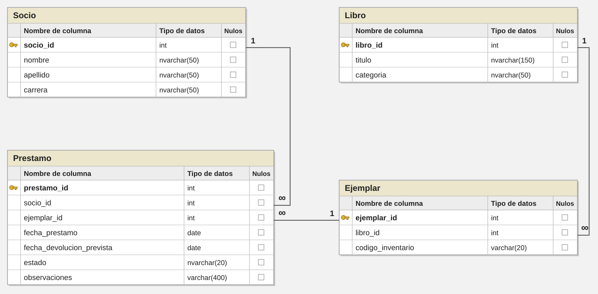

author: Diego Eduardo Castro Quintanilla
summary: Guía informativa de índices y esquemas en SQL Server con ejemplos sobre BibliotecaLab04 y una carga total de 50 000 registros. Ciclo 02-2026, versión 2.
id: g04
categories: databases
environments: Web
status: Published

# Laboratorio 4 — Índices y esquemas en SQL Server

## Introducción
Duration: 6

Esta guía explica los contenidos de clase sobre **índices y esquemas en SQL Server**. Los ejemplos utilizan `BibliotecaLab04` para mostrar cómo se crean los índices, qué beneficio ofrece cada uno y cómo se organizan las tablas y sus permisos.

El propósito es **comprender los conceptos y la función de los comandos**. El ejercicio práctico se desarrolla por separado, según las indicaciones del instructor.

### Cuándo se utilizan

Los índices se consideran para **consultas frecuentes o costosas**, especialmente cuando una columna se utiliza para filtrar con `WHERE`. En esta guía aparecen búsquedas por socio, apellido, carrera, código de inventario y fecha.

**El beneficio debe corresponder a una consulta concreta.** Cada índice también ocupa espacio y añade trabajo cuando se insertan, actualizan o eliminan datos.

> **Idea clave:** no existe una cantidad de índices adecuada para todas las tablas. Conviene conservar los que aportan un beneficio y evitar duplicaciones innecesarias.

## Índices
Duration: 17

Un **índice** es una estructura que ayuda a SQL Server a encontrar información dentro de una tabla. Funciona de manera parecida al índice de un libro: permite localizar un tema sin revisar todas sus páginas.

Por ejemplo, una biblioteca necesita consultar los préstamos de un socio. Si no dispone de un índice adecuado, el motor puede recorrer todos los préstamos para encontrar los que pertenecen a esa persona. Un **índice por `socio_id`** puede facilitar esa búsqueda.

### Base de datos de los ejemplos

El siguiente bloque crea **las cuatro tablas y sus relaciones**, sin insertar datos. Se utiliza una base nueva llamada `BibliotecaLab04`.

```sql
USE master;
GO
CREATE DATABASE BibliotecaLab04;
GO
USE BibliotecaLab04;
GO
CREATE TABLE dbo.Socio (
    socio_id INT NOT NULL,
    nombre NVARCHAR(50) NOT NULL,
    apellido NVARCHAR(50) NOT NULL,
    carrera NVARCHAR(50) NOT NULL,
    CONSTRAINT PK_Socio PRIMARY KEY NONCLUSTERED (socio_id)
);
CREATE TABLE dbo.Libro (
    libro_id INT NOT NULL,
    titulo NVARCHAR(150) NOT NULL,
    categoria NVARCHAR(50) NOT NULL,
    CONSTRAINT PK_Libro PRIMARY KEY CLUSTERED (libro_id)
);
CREATE TABLE dbo.Ejemplar (
    ejemplar_id INT NOT NULL,
    libro_id INT NOT NULL,
    codigo_inventario VARCHAR(20) NOT NULL,
    CONSTRAINT PK_Ejemplar PRIMARY KEY CLUSTERED (ejemplar_id),
    CONSTRAINT FK_Ejemplar_Libro FOREIGN KEY (libro_id)
        REFERENCES dbo.Libro(libro_id)
);
CREATE TABLE dbo.Prestamo (
    prestamo_id INT NOT NULL,
    socio_id INT NOT NULL,
    ejemplar_id INT NOT NULL,
    fecha_prestamo DATE NOT NULL,
    fecha_devolucion_prevista DATE NOT NULL,
    estado NVARCHAR(20) NOT NULL,
    observaciones VARCHAR(400) NOT NULL,
    CONSTRAINT PK_Prestamo PRIMARY KEY CLUSTERED (prestamo_id),
    CONSTRAINT FK_Prestamo_Socio FOREIGN KEY (socio_id)
        REFERENCES dbo.Socio(socio_id),
    CONSTRAINT FK_Prestamo_Ejemplar FOREIGN KEY (ejemplar_id)
        REFERENCES dbo.Ejemplar(ejemplar_id)
);
GO
```

La clave primaria de `Socio` se define como **no agrupada** para poder mostrar después un `CREATE CLUSTERED INDEX` sobre su apellido. Las otras tres claves primarias se definen como agrupadas.



### Datos para los ejemplos

El [archivo de inserciones de BibliotecaLab04](g04/descargas/Carga-BibliotecaLab04.sql) contiene únicamente cuatro instrucciones `INSERT ... SELECT`. Genera **50 000 registros en total**: 1 000 socios, 500 libros, 3 500 ejemplares y 45 000 préstamos.

La carga se ejecuta **una sola vez sobre las tablas vacías**. Las observaciones son textos breves y los préstamos incluyen distintos socios, estados y fechas.

<!-- sql-external: g04/descargas/Carga-BibliotecaLab04.sql -->

> **Consejo:** el archivo reducido no elimina datos cargados anteriormente. Los ejemplos parten de una base nueva; si ya existe una versión poblada, el instructor indicará cómo preparar la base de trabajo.

### Ejemplo de una búsqueda

La consulta obtiene los **45 préstamos del socio 308**:

```sql
USE BibliotecaLab04;
GO
SELECT prestamo_id, socio_id, fecha_devolucion_prevista, estado
FROM dbo.Prestamo
WHERE socio_id=308;
GO
```

La tabla tiene un índice agrupado por `prestamo_id`, pero la búsqueda utiliza `socio_id`. **Un índice útil depende de la columna y la condición de la consulta**, no solo de que la tabla tenga una clave primaria.

### Cómo se observa el efecto de un índice

El **plan de ejecución** muestra cómo SQL Server obtiene los datos. En SSMS, `Ctrl + M` activa el plan real. Estas opciones muestran las lecturas y los tiempos en la pestaña **Mensajes**:

```sql
SET STATISTICS IO ON;
SET STATISTICS TIME ON;
GO
```

Los operadores utilizados en los ejemplos son:

* **Clustered Index Scan:** recorre el índice agrupado que contiene las filas de la tabla.
* **Index Scan:** recorre un índice no agrupado.
* **Index Seek:** localiza una clave o un rango mediante un índice.
* **Key Lookup:** recupera del índice agrupado columnas que faltan en el no agrupado.

Las **lecturas lógicas** representan accesos a páginas en memoria. El **tiempo de CPU** refleja trabajo del procesador y el **tiempo transcurrido** también incluye esperas. Para observar una mejora se compara la misma consulta antes y después de crear su índice.

> **Idea clave:** con 45 000 préstamos, las diferencias de tiempo pueden ser pequeñas o mostrarse como 0 ms. El plan y las lecturas lógicas ayudan a entender el efecto. Un `Scan` puede ser razonable y un `Seek` no garantiza por sí solo que toda la consulta sea eficiente.

## Tipos de índice
Duration: 25

Los ejemplos siguientes muestran **cómo crear cada índice, cuándo utilizarlo y qué beneficio aporta**. Los objetos se crean en el orden presentado y pertenecen a `BibliotecaLab04`.

### Índice agrupado — CLUSTERED

**Organiza las filas de la tabla por la clave del índice.** Su nivel hoja contiene los datos completos y solo puede existir uno por tabla.

**Beneficio del ejemplo:** facilita localizar socios por apellido. `Socio` todavía no tiene un índice agrupado, porque su clave primaria se creó como `NONCLUSTERED`.

```sql
CREATE CLUSTERED INDEX IX_Socio_Apellido
ON dbo.Socio(apellido);
GO
SELECT socio_id, nombre, apellido
FROM dbo.Socio
WHERE apellido=N'Apellido 25';
GO
```

Este apellido corresponde a **cinco socios**. El índice agrupado permite localizar sus filas por esa clave.

> **Consejo:** la organización del índice no garantiza el orden de salida de una consulta. Para ordenar los resultados se utiliza `ORDER BY`.

### Índice no agrupado — NONCLUSTERED

**Crea una estructura adicional con las claves de búsqueda y un localizador de las filas.** Una tabla puede tener varios índices no agrupados.

**Beneficio del ejemplo:** facilita buscar los préstamos de un socio sin recorrer todos los préstamos.

```sql
CREATE NONCLUSTERED INDEX IX_Prestamo_Socio
ON dbo.Prestamo(socio_id);
GO
SELECT prestamo_id, socio_id, fecha_devolucion_prevista, estado
FROM dbo.Prestamo
WHERE socio_id=308;
GO
```

Puede aparecer un **Index Seek** acompañado de un **Key Lookup**, porque el índice encuentra al socio pero debe recuperar la fecha y el estado desde las filas completas.

### Índice compuesto

**Utiliza más de una columna como clave.** El orden de las columnas determina cómo se organiza la búsqueda.

**Beneficio del ejemplo:** facilita localizar socios de una carrera y un apellido concretos.

```sql
CREATE NONCLUSTERED INDEX IX_Socio_Carrera_Apellido
ON dbo.Socio(carrera, apellido);
GO
SELECT socio_id, carrera, apellido
FROM dbo.Socio
WHERE carrera=N'Psicología' AND apellido=N'Apellido 25';
GO
```

La consulta devuelve **un socio**. `carrera` es la **columna líder**: el índice también puede apoyar búsquedas por carrera. Una búsqueda únicamente por apellido puede aprovechar el índice agrupado creado anteriormente.

> **Idea clave:** un índice `(A, B)` organiza primero por `A` y después por `B`. Cambiar el orden de las columnas cambia las posibilidades de búsqueda.

### Índice único — UNIQUE

**Impide valores duplicados en la clave del índice.**

**Beneficio del ejemplo:** protege el código de inventario de cada ejemplar y permite buscarlo por ese código.

```sql
CREATE UNIQUE NONCLUSTERED INDEX UX_Ejemplar_Codigo
ON dbo.Ejemplar(codigo_inventario);
GO
SELECT ejemplar_id, libro_id, codigo_inventario
FROM dbo.Ejemplar
WHERE codigo_inventario='EJ-000308';
GO
```

El código corresponde a **un ejemplar**. Si otra fila intentara utilizar el mismo código, SQL Server rechazaría la operación por duplicidad.

### Índice filtrado

**Incluye únicamente las filas que cumplen una condición.**

**Beneficio del ejemplo:** permite buscar fechas de devolución entre los préstamos vencidos mediante un índice que contiene solo ese subconjunto.

Las siguientes opciones de sesión permiten crear y utilizar el índice filtrado:

```sql
SET ANSI_NULLS ON;
SET QUOTED_IDENTIFIER ON;
SET ANSI_PADDING ON;
SET ANSI_WARNINGS ON;
SET ARITHABORT ON;
SET CONCAT_NULL_YIELDS_NULL ON;
SET NUMERIC_ROUNDABORT OFF;
GO
CREATE NONCLUSTERED INDEX IX_Prestamo_Vencido_Fecha
ON dbo.Prestamo(fecha_devolucion_prevista)
WHERE estado=N'Vencido';
GO
SELECT prestamo_id, fecha_devolucion_prevista
FROM dbo.Prestamo
WHERE estado=N'Vencido'
  AND fecha_devolucion_prevista >= '20260101'
  AND fecha_devolucion_prevista < '20260201';
GO
```

**El filtro de la consulta coincide con el filtro del índice.** Este índice no contiene los préstamos activos o devueltos.

### Índice con columnas incluidas — INCLUDE

**Permite cubrir una consulta:** el índice contiene todos los datos que esta necesita. Las columnas de `INCLUDE` se guardan en el nivel hoja, sin formar parte de la clave de búsqueda.

**Beneficio del ejemplo:** entrega la fecha y el estado de los préstamos del socio desde el propio índice y puede evitar el `Key Lookup`.

Este bloque reemplaza el índice simple creado anteriormente:

```sql
DROP INDEX IX_Prestamo_Socio ON dbo.Prestamo;
GO
CREATE NONCLUSTERED INDEX IX_Prestamo_Socio
ON dbo.Prestamo(socio_id)
INCLUDE(fecha_devolucion_prevista, estado);
GO
SELECT prestamo_id, socio_id, fecha_devolucion_prevista, estado
FROM dbo.Prestamo
WHERE socio_id=308;
GO
```

`prestamo_id` ya está disponible en el índice no agrupado como localizador, porque es la clave agrupada de `Prestamo`.

> **Idea clave:** `socio_id` permite buscar. Las columnas incluidas permiten completar el resultado. **Incluir solo las columnas necesarias** ayuda a controlar el tamaño del índice.

## Mantenimiento de índices
Duration: 15

El mantenimiento permite **revisar y conservar las estructuras que utiliza SQL Server para buscar datos**. Las inserciones, actualizaciones y eliminaciones pueden cambiar la distribución de sus páginas.

Los ejemplos utilizan `IX_Prestamo_Socio`, creado en la sección anterior.

### 1. Identificar los índices de una tabla

`sys.indexes` permite conocer **qué índices existen y de qué tipo son**:

```sql
SELECT name AS Indice, type_desc AS Tipo
FROM sys.indexes
WHERE object_id=OBJECT_ID(N'dbo.Prestamo');
GO
```

El resultado incluye la clave primaria agrupada, el índice por socio y el índice filtrado de vencidos.

### 2. Consultar la fragmentación

La **fragmentación** indica que el orden de las páginas puede diferir del orden lógico del índice. La siguiente consulta muestra el porcentaje de fragmentación y la cantidad de páginas del índice por socio:

```sql
SELECT i.name AS Indice,
       p.page_count AS Paginas,
       p.avg_fragmentation_in_percent AS Fragmentacion
FROM sys.dm_db_index_physical_stats
     (DB_ID(),OBJECT_ID(N'dbo.Prestamo'),NULL,NULL,'LIMITED') AS p
JOIN sys.indexes AS i
  ON i.object_id=p.object_id AND i.index_id=p.index_id
WHERE i.name=N'IX_Prestamo_Socio'
  AND p.index_level=0;
GO
```

**Paginas** indica el tamaño del índice en páginas y **Fragmentacion** expresa el porcentaje observado.

> **Consejo:** un índice recién creado puede tener poca fragmentación. El porcentaje por sí solo no significa que una consulta sea lenta; también importan el tamaño del índice y su uso.

### 3. Reorganizar un índice

**REORGANIZE reorganiza las páginas del nivel hoja** del índice existente.

```sql
ALTER INDEX IX_Prestamo_Socio
ON dbo.Prestamo REORGANIZE;
GO
```

**Beneficio:** mejora la organización de sus páginas sin reconstruir toda la estructura. En clase se presenta como opción para una fragmentación inferior al 30 %, cuando el mantenimiento se justifica.

### 4. Reconstruir un índice

**REBUILD vuelve a construir la estructura del índice.**

```sql
ALTER INDEX IX_Prestamo_Socio
ON dbo.Prestamo REBUILD;
GO
```

**Beneficio:** permite corregir la fragmentación mediante una reconstrucción. En clase se utiliza como referencia una fragmentación superior al 30 %.

> **Idea clave:** reorganizar y reconstruir son alternativas de mantenimiento. **No es necesario ejecutar ambas cada vez.** El 30 % es una referencia didáctica; la decisión también depende del tamaño, el uso y los recursos disponibles.

### 5. Eliminar un índice

**DROP INDEX elimina el índice y conserva las filas de la tabla.** Se utiliza cuando un índice deja de ser útil o se va a reemplazar.

```sql
DROP INDEX IX_Socio_Carrera_Apellido ON dbo.Socio;
GO
```

Este ejemplo elimina el índice compuesto presentado anteriormente. **Beneficio:** libera el espacio de esa estructura y evita su mantenimiento en futuras escrituras. Una eliminación real debe justificarse con las consultas que utilizan la tabla.

## Esquemas
Duration: 25

Un **esquema** es un contenedor lógico de objetos de una base de datos, como tablas, vistas o procedimientos. Se utiliza para **organizar objetos por función y administrar permisos en conjunto**.

En `Circulacion.Prestamo`, `Circulacion` es el esquema y `Prestamo` es la tabla. Ambos siguen dentro de `BibliotecaLab04`. El ejemplo organiza los préstamos y socios en esa área.

### 1. Crear un esquema

**CREATE SCHEMA crea el contenedor** y `AUTHORIZATION` indica su propietario.

```sql
USE BibliotecaLab04;
GO
CREATE SCHEMA Circulacion AUTHORIZATION dbo;
GO
```

El esquema `Circulacion` queda creado y su propietario es `dbo`. En este momento todavía está vacío.

### 2. Transferir una tabla

**ALTER SCHEMA ... TRANSFER cambia el esquema de un objeto.**

```sql
ALTER SCHEMA Circulacion TRANSFER dbo.Prestamo;
GO
```

La tabla pasa de `dbo.Prestamo` a **`Circulacion.Prestamo`**. Sus filas permanecen en la misma base.

El mismo comando permite incorporar los socios:

```sql
ALTER SCHEMA Circulacion TRANSFER dbo.Socio;
GO
```

Ahora se utiliza **`Circulacion.Socio`**. Las tablas `Libro` y `Ejemplar` conservan el esquema `dbo`.

> **Consejo:** los índices y las claves foráneas siguen asociados a la tabla. Las consultas que escribían el nombre anterior deben actualizarse. Los permisos directos del objeto se eliminan al transferirlo y deben revisarse.

### 3. Consultar el contenido y el propietario

Esta consulta muestra **las tablas del esquema**:

```sql
SELECT t.name AS Tabla
FROM sys.tables AS t
JOIN sys.schemas AS s ON s.schema_id=t.schema_id
WHERE s.name=N'Circulacion';
GO
```

El resultado incluye `Prestamo` y `Socio`. La siguiente consulta identifica **quién es su propietario**:

```sql
SELECT name AS Esquema, USER_NAME(principal_id) AS Propietario
FROM sys.schemas
WHERE name=N'Circulacion';
GO
```

### 4. Cambiar el propietario

**ALTER AUTHORIZATION reasigna la propiedad del esquema.** Un rol de base de datos puede ser propietario:

```sql
CREATE ROLE rolAdministracion;
ALTER AUTHORIZATION ON SCHEMA::Circulacion TO rolAdministracion;
GO
```

`rolAdministracion` pasa a ser propietario de `Circulacion`. Para los ejemplos de lectura que siguen, la propiedad se devuelve a `dbo`:

```sql
ALTER AUTHORIZATION ON SCHEMA::Circulacion TO dbo;
GO
```

> **Idea clave:** **ser propietario** y **tener permiso de lectura** son responsabilidades distintas. El usuario de consulta recibirá solo el permiso que necesita.

### 5. Preparar el usuario y el rol de consulta

El **login** permite acceder al servidor:

```sql
USE master;
GO
CREATE LOGIN loginBiblioteca WITH PASSWORD='Biblioteca2026!';
GO
```

El **usuario** representa esa identidad dentro de `BibliotecaLab04`:

```sql
USE BibliotecaLab04;
GO
CREATE USER usuarioBiblioteca FOR LOGIN loginBiblioteca;
GO
```

El **rol** agrupa usuarios para administrar sus permisos. Este bloque crea el rol y agrega al usuario:

```sql
CREATE ROLE rolConsulta;
ALTER ROLE rolConsulta ADD MEMBER usuarioBiblioteca;
GO
```

### 6. Conceder lectura sobre el esquema

**GRANT concede un permiso.** En este ejemplo, el rol recibe lectura sobre las tablas de `Circulacion`:

```sql
GRANT SELECT ON SCHEMA::Circulacion TO rolConsulta;
GO
```

**Beneficio:** un único permiso permite leer `Prestamo` y `Socio` dentro de ese esquema.

El siguiente bloque muestra la consulta con la identidad del usuario. El plan de ejecución real debe estar desactivado con `Ctrl + M`, porque esa cuenta no tiene permiso `SHOWPLAN`.

```sql
EXECUTE AS USER='usuarioBiblioteca';
SELECT TOP (5) prestamo_id, socio_id, estado
FROM Circulacion.Prestamo ORDER BY prestamo_id;
REVERT;
GO
```

**EXECUTE AS** cambia temporalmente el contexto y **REVERT** regresa al usuario original. La consulta está permitida por la pertenencia a `rolConsulta`.

### 7. Retirar el permiso

**REVOKE retira la concesión del permiso** en el ámbito indicado:

```sql
REVOKE SELECT ON SCHEMA::Circulacion FROM rolConsulta;
GO
```

En este ejemplo, el usuario ya no recibe lectura sobre `Circulacion` por ese rol. Si tuviera otras concesiones, habría que revisarlas para determinar su acceso efectivo.

El permiso se restaura de esta forma:

```sql
GRANT SELECT ON SCHEMA::Circulacion TO rolConsulta;
GO
```

> **Consejo:** la comprobación de permisos debe realizarse con el usuario de consulta. Una cuenta administradora puede acceder por otros privilegios y ocultar el efecto del ejemplo.

### 8. Eliminar un esquema vacío

**DROP SCHEMA elimina un esquema que no contiene objetos.** Este ejemplo crea y elimina un contenedor temporal:

```sql
CREATE SCHEMA Temporal AUTHORIZATION dbo;
GO
DROP SCHEMA Temporal;
GO
```

`Circulacion` se conserva porque contiene las tablas utilizadas en los ejemplos.

## Comandos de índices y esquemas
Duration: 5

Esta tabla reúne **los comandos de índices y esquemas utilizados en la guía**. Los ejemplos son una referencia de sintaxis; no constituyen una segunda secuencia de ejecución.

| Comando | Uso | Ejemplo |
| --- | --- | --- |
| `CREATE CLUSTERED INDEX` | Crear el índice agrupado de una tabla. | `CREATE CLUSTERED INDEX IX_Socio_Apellido ON dbo.Socio(apellido);` |
| `CREATE NONCLUSTERED INDEX` | Crear un índice adicional. | `CREATE NONCLUSTERED INDEX IX_Prestamo_Socio ON dbo.Prestamo(socio_id);` |
| `CREATE INDEX` con varias columnas | Crear una clave compuesta. | `CREATE NONCLUSTERED INDEX IX_Socio_Carrera_Apellido ON dbo.Socio(carrera,apellido);` |
| `CREATE UNIQUE INDEX` | Evitar claves duplicadas. | `CREATE UNIQUE NONCLUSTERED INDEX UX_Ejemplar_Codigo ON dbo.Ejemplar(codigo_inventario);` |
| `CREATE INDEX ... WHERE` | Indexar un subconjunto. | `CREATE NONCLUSTERED INDEX IX_Prestamo_Vencido_Fecha ON dbo.Prestamo(fecha_devolucion_prevista) WHERE estado=N'Vencido';` |
| `CREATE INDEX ... INCLUDE` | Incluir columnas para cubrir una consulta. | `CREATE NONCLUSTERED INDEX IX_Prestamo_Socio ON dbo.Prestamo(socio_id) INCLUDE(fecha_devolucion_prevista,estado);` |
| `ALTER INDEX ... REORGANIZE` | Reorganizar el nivel hoja. | `ALTER INDEX IX_Prestamo_Socio ON dbo.Prestamo REORGANIZE;` |
| `ALTER INDEX ... REBUILD` | Reconstruir la estructura. | `ALTER INDEX IX_Prestamo_Socio ON dbo.Prestamo REBUILD;` |
| `DROP INDEX` | Eliminar el índice sin borrar las filas. | `DROP INDEX IX_Socio_Carrera_Apellido ON dbo.Socio;` |
| `CREATE SCHEMA` | Crear un esquema y definir su propietario. | `CREATE SCHEMA Circulacion AUTHORIZATION dbo;` |
| `ALTER SCHEMA ... TRANSFER` | Transferir un objeto. | `ALTER SCHEMA Circulacion TRANSFER dbo.Prestamo;` |
| `ALTER AUTHORIZATION` | Reasignar la propiedad. | `ALTER AUTHORIZATION ON SCHEMA::Circulacion TO dbo;` |
| `DROP SCHEMA` | Eliminar un esquema vacío. | `DROP SCHEMA Temporal;` |

## Ejercicio práctico
Duration: 5

**Desarrolla el ejercicio práctico siguiendo las indicaciones del instructor del laboratorio.** El instructor proporcionará el enunciado y las orientaciones para su realización.

## Créditos
Duration: 0

Departamento de Electrónica e Informática, Universidad Centroamericana José Simeón Cañas, La Libertad, El Salvador.

| Versión | Autor | Ciclo |
| --- | --- | --- |
| 1 | Diego Eduardo Castro Quintanilla (00117322@uca.edu.sv) | 01-2025 |
| 2 | Diego Eduardo Castro Quintanilla (00117322@uca.edu.sv) | 02-2026 |

### Material de clase de referencia

* **16_Gestión de índices:** definición, tipos, creación, eliminación, fragmentación y monitoreo.
* **AA-Índices** y **AA-Los planes de ejecución:** organización de índices, cobertura, operadores y lectura de planes.
* **Guia_Practica_Planes_Ejecucion_Indices_SQLServer:** comparación antes/después, selectividad, índices compuestos, rangos y uniones.
* **Buenas Prácticas en la Gestión de Índices:** elección de columnas, mantenimiento, uso y documentación.
* **19_Esquema y Seguridad:** organización, transferencia, propiedad y permisos por esquema.

Los ejemplos adaptan esos contenidos a `BibliotecaLab04`. Los datos son ficticios. Los planes y tiempos dependen del motor, los recursos, las estadísticas y los índices disponibles.

Este trabajo se distribuye bajo la licencia [Creative Commons Atribución-NoComercial-CompartirIgual 4.0 Internacional](https://creativecommons.org/licenses/by-nc-sa/4.0/).
