author: Diego Eduardo Castro Quintanilla
summary: Guía paso a paso de copias de seguridad y restauración en SQL Server con NotasLab05, explicaciones de comandos y resultados de cada actividad. Ciclo 02-2026, versión 2.
id: g05
categories: databases
environments: Web
status: Published

# Laboratorio 5 — Copias de seguridad en SQL Server

## Introducción
Duration: 5

Una **copia de seguridad o respaldo** guarda información que podremos utilizar si una base de datos se pierde, se daña o se modifica por error. **Restaurar** consiste en utilizar esos archivos para reconstruir la base y recuperar un estado anterior de sus datos.

En esta guía trabajarás con `NotasLab05`, una base de calificaciones. Crearás una copia completa, guardarás cambios mediante un respaldo diferencial y un respaldo del registro de transacciones, y recuperarás la base después de eliminarla como parte de la práctica. También exportarás e importarás una tabla, programarás un respaldo automático y revisarás cómo asociar una notificación por fallo.

Antes del ejemplo conocerás **RPO, RTO, WRT y MTD**: criterios que ayudan a decidir cuántos datos se pueden perder y cuánto tiempo puede permanecer interrumpido un servicio. Al terminar, compararás las calificaciones recuperadas con las originales para comprobar el resultado de la restauración.

### Objetivo general

**Aplicar una estrategia de respaldo y restauración de una base de datos en SQL Server**, mediante la creación y aplicación ordenada de respaldos completos, diferenciales y del registro de transacciones sobre `NotasLab05`, **para recuperar información ante una falla y evaluar la pérdida de datos y el tiempo de recuperación frente a los objetivos RPO y RTO**.

### Objetivos específicos

* Interpretar RPO, RTO, WRT y MTD mediante un escenario de interrupción del servicio, para establecer los límites de pérdida de datos y tiempo de recuperación.
* Crear y restaurar respaldos mediante los comandos `BACKUP` y `RESTORE`, para recuperar las calificaciones y comprobar qué cambios conserva cada copia.
* Exportar e importar datos mediante `bcp`, y guardar consultas mediante `sqlcmd`, para distinguir estas operaciones de la restauración de una base completa.
* Automatizar un respaldo mediante un trabajo de SQL Server Agent y la asociación de un operador, para ejecutar la tarea periódicamente y preparar su notificación en caso de fallo.

## RPO y RTO
Duration: 7

Cuando un servicio falla, hay dos problemas distintos: **pueden perderse cambios recientes** y **los usuarios dejan de trabajar mientras se recupera el sistema**. Los siguientes conceptos permiten planificar ambos problemas. Son criterios de recuperación que define la organización; no son comandos que debas ejecutar en SQL Server.

| Sigla | Nombre completo de las siglas | Qué es | Para qué sirve y cómo interpretarlo |
| --- | --- | --- | --- |
| **RPO** | **Recovery Point Objective** — Objetivo de punto de recuperación. | Límite de pérdida de datos aceptable, expresado como un intervalo de tiempo anterior a la falla. | Ayuda a decidir la frecuencia de los respaldos. Con RPO de 15 minutos y una falla a las 10:00, se necesita poder recuperar al menos hasta las 9:45. |
| **RTO** | **Recovery Time Objective** — Objetivo de tiempo de recuperación. | Plazo objetivo para recuperar el sistema desde que ocurre la interrupción. | Ayuda a elegir y probar el procedimiento de restauración. Con RTO de 30 minutos y falla a las 10:00, el sistema debe estar recuperado a más tardar a las 10:30. |
| **WRT** | **Work Recovery Time** — Tiempo de recuperación del trabajo. | Tiempo necesario para verificar el sistema recuperado y reanudar el trabajo de los usuarios. | Permite reservar tiempo para revisar datos, conexiones y operaciones. Si la recuperación termina a las 10:30 y el WRT previsto es de 10 minutos, se espera normalizar el trabajo a las 10:40. |
| **MTD** | **Maximum Tolerable Downtime** — Tiempo máximo tolerable de interrupción. | Límite total de tiempo que el negocio puede permanecer sin servicio antes de sufrir consecuencias inaceptables. | Sirve para comprobar que la recuperación y la reanudación caben dentro del plazo tolerable. Con MTD de 45 minutos y falla a las 10:00, el límite es las 10:45. |

### Un ejemplo con el sistema de calificaciones

Imagina que el sistema se detiene a las **10:00**. El **RPO** indica cuántos minutos de calificaciones recientes se acepta perder. El **RTO** indica el plazo para recuperar el sistema. El **WRT** reserva tiempo para que el personal revise las notas y vuelva a trabajar. El **MTD** marca el límite total que la institución puede tolerar sin ese servicio.

Con los valores de la tabla, recuperar el sistema a las 10:30 y dedicar 10 minutos a verificarlo permite reanudar el trabajo a las 10:40, antes del límite de las 10:45. En el esquema de clase, se busca que **RTO + WRT no supere el MTD**. Son valores de ejemplo, no valores obligatorios para todas las bases de datos.


En el esquema usado en clase, RTO y WRT se planifican dentro del MTD. El MTD es un **límite tolerable**, no una fase adicional denominada «test y verificación». Los objetivos dependen de la criticidad de cada servicio.

### Comparación de estrategias

Se toma un completo el domingo a las 2:00 a. m. Los incrementales se hacen cada seis horas **desde el domingo a las 8:00 a. m.**, y los diferenciales diariamente a las 6:00 p. m. La falla ocurre el jueves a las 4:30 p. m. Se comparan por separado completo solo, completo con diferenciales y completo con incrementales.

| Estrategia | Último respaldo disponible | Ventana de pérdida en esta falla | Respaldos por restaurar |
| --- | --- | --- | --- |
| Completo | Domingo, 2:00 a. m. | 110.5 horas | 1 |
| Completo + diferencial | Miércoles, 6:00 p. m. | 22.5 horas | 2 |
| Completo + incrementales | Jueves, 2:00 p. m. | 2.5 horas | 19: un completo y 18 incrementales |

Las **2.5 horas son la pérdida potencial del caso concreto**. El RPO es el objetivo con el que se compara esa pérdida. Respaldar cada seis horas no garantiza perder siempre solo 2.5 horas.

La cantidad de archivos describe el trabajo de restauración. **No mide el RTO**. Una cadena larga puede aumentar el tiempo de recuperación, pero hay que medirlo: también influyen el tamaño de los respaldos, la actividad registrada y los recursos del servidor.

El calendario contiene 3 incrementales del domingo, 4 de cada día de lunes a miércoles y 3 del jueves: 18 incrementales. Con el completo son **19 restauraciones**.

## Tipos de respaldo
Duration: 7

Un **respaldo lógico** exporta la definición de objetos o sus datos. La definición describe cómo crear tablas y columnas; los datos son las filas que contienen. Generar scripts puede producir instrucciones `CREATE` e `INSERT`; `bcp` exporta datos y puede usar un formato binario nativo. Por eso no todos los respaldos lógicos son archivos legibles como texto.

El **registro de transacciones**, también llamado **log**, conserva información sobre los cambios realizados en la base. Su respaldo permite aplicar cambios posteriores a una copia completa o diferencial. La **cadena de restauración** es la secuencia de archivos compatibles que debemos aplicar en orden.

Un **respaldo nativo de SQL Server** creado con `BACKUP` contiene los datos y la información necesaria para recuperarlos de forma consistente. No equivale a copiar manualmente los archivos MDF y LDF mientras la base está en uso.


| Respaldo | Qué conserva | Cómo se usa al restaurar |
| --- | --- | --- |
| **Completo** | La base y el registro necesario para que el respaldo sea consistente. | Es el punto de partida. |
| **Diferencial** | Las extensiones de datos modificadas desde su completo base. | Se aplica después del completo al que corresponde. |
| **Del log** | Registros de transacciones que mantienen la continuidad de la cadena de log. | Se aplican los logs necesarios, en orden, después del completo o del diferencial. |

En la comparación general de clase, «incremental» significa cambios desde el respaldo anterior. En SQL Server usamos **BACKUP LOG** para conservar la secuencia de transacciones; no existe una cláusula `WITH INCREMENTAL`. Un respaldo completo normal no reinicia por sí mismo una cadena de log ya establecida.

El **modelo de recuperación** es una configuración de la base que determina cómo se gestiona el registro de transacciones y qué posibilidades de recuperación tendremos. Usaremos el modelo **FULL**, que permite conservar una cadena de respaldos del log. SQL Server admite respaldos del log en `FULL` y `BULK_LOGGED`, pero no en `SIMPLE`. Al comenzar con esta base nueva en FULL, el primer completo establece la base necesaria para iniciar los respaldos del log.

### Qué debe ocurrir

| Momento | Filas en la tabla | Qué queda respaldado |
| --- | --- | --- |
| Crear datos y tomar el completo | 6 | Calificaciones 1 a 6. |
| Agregar 7 y 8 y tomar el diferencial | 8 | Cambios desde el completo. |
| Agregar 9, corregir la nota 2 y respaldar el log | 9 | Cambios hasta ese respaldo del log. |
| Agregar 10, sin otro respaldo | 10 | La fila 10 queda fuera de los respaldos. |
| Restaurar completo, diferencial y log | 9 | La nota 2 vuelve con 7.25; la fila 10 no vuelve. |


## Preparar el entorno
Duration: 8

Antes de ejecutar comandos, abre **Docker Desktop**. En **Containers**, localiza `sqlserver-2025`; si está detenido, pulsa su botón de inicio y espera a que aparezca en ejecución. Usarás el entorno de clase con SQL Server 2025 Developer y su carpeta de respaldos `/backup`.

Mantén abiertas PowerShell y SQL Server Management Studio durante la práctica. Cada actividad te indicará a cuál regresar. En SSMS utiliza la misma conexión que ya empleaste en los laboratorios anteriores, con la cuenta y permisos proporcionados por el instructor.

La base `NotasLab05` debe estar libre para crear el ejemplo. Si ya existe, el código avisará y deberás revisar con el instructor si pertenece a otra práctica antes de continuar.

### Crear la carpeta de respaldos

Continúa en la misma ventana de **PowerShell**. Copia el bloque siguiente, presiona **Enter** y espera a que vuelva a aparecer el indicador `PS`.

El primer comando crea la carpeta; el segundo confirma su ubicación.

**Qué hacen los comandos:** `docker exec` ejecuta una instrucción dentro del contenedor indicado. `mkdir` crea una carpeta y `-p` permite crear sus carpetas superiores si faltan. `ls -d` muestra la ruta de la carpeta para confirmar que existe. `/backup/NotasLab05` está dentro del contenedor, no es una ruta de Windows.

<!-- lab-step: 02 -->
```powershell
docker exec sqlserver-2025 mkdir -p /backup/NotasLab05
docker exec sqlserver-2025 ls -d /backup/NotasLab05
```

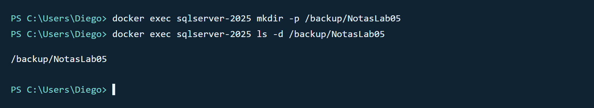

**Comprueba:** Se muestra `/backup/NotasLab05`. `mkdir` normalmente no imprime nada al funcionar. Si aparece «Permission denied», pide al instructor revisar los permisos del volumen.

### Crear la base en FULL

Abre **SQL Server Management Studio (SSMS)** y conéctate a la instancia de SQL Server que utilizas en clase. En la barra superior, haz clic en **Nueva consulta**. Se abrirá una pestaña con un área blanca para escribir código. Pega allí el bloque siguiente y pulsa **Ejecutar** o **F5**. Conserva esta pestaña para las siguientes consultas.

La comprobación inicial evita reutilizar una base existente. Ejecuta este bloque una sola vez.

**Qué hace el código:** `USE master` selecciona la base de administración del servidor. `DB_ID` consulta si `NotasLab05` ya existe; `IF` evalúa esa condición y `THROW` detiene este bloque con un mensaje si encuentra la base. `EXEC` ejecuta las instrucciones de creación y configuración. `CREATE DATABASE` crea la base; `ALTER DATABASE ... SET RECOVERY FULL` selecciona el modelo que usaremos para respaldar el log. `SELECT` consulta `sys.databases`, el catálogo de bases del servidor, y `WHERE` limita el resultado a `NotasLab05`.

**Cómo leer el resultado:** `name` es el nombre de la base, `recovery_model_desc` indica su modelo de recuperación y `state_desc` indica su estado. `ONLINE` significa que está disponible.

<!-- lab-step: 03 -->
```sql
USE master;
IF DB_ID(N'NotasLab05') IS NOT NULL
    THROW 50001, N'NotasLab05 ya existe. Revisa el entorno antes de continuar.', 1;
EXEC(N'CREATE DATABASE NotasLab05');
EXEC(N'ALTER DATABASE NotasLab05 SET RECOVERY FULL');
SELECT name, recovery_model_desc, state_desc
FROM sys.databases WHERE name = N'NotasLab05';
```

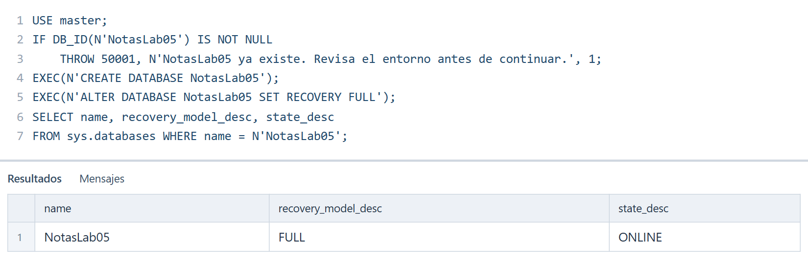

**Comprueba:** La base aparece en `FULL` y `ONLINE`. Si ya existía, detente: conserva sus datos y consulta al instructor.

### Crear la tabla y los datos iniciales

Continúa en la misma pestaña de consulta de **SQL Server Management Studio**. Sustituye el código anterior por el bloque siguiente y pulsa **Ejecutar** o **F5**.

Ahora agrega seis calificaciones ficticias.

<!-- lab-step: 04 -->
```sql
USE NotasLab05;
CREATE TABLE dbo.Calificacion (
    calificacion_id INT PRIMARY KEY,
    estudiante NVARCHAR(60) NOT NULL,
    nota DECIMAL(4,2) NOT NULL
);
INSERT INTO dbo.Calificacion VALUES
(1, N'Ana Martínez', 8.50), (2, N'Luis Hernández', 6.75),
(3, N'María López', 9.25), (4, N'Carlos Rivas', 7.00),
(5, N'Sofía Pérez', 8.00), (6, N'Jorge Ramírez', 5.50);
SELECT * FROM dbo.Calificacion ORDER BY calificacion_id;
```

**Comprueba:** Hay seis filas. La nota de Luis, con identificador 2, es **6.75**.

## Crear respaldos
Duration: 12

### Tomar el respaldo completo

Continúa en la misma pestaña de consulta de **SQL Server Management Studio**. Sustituye el código anterior por el bloque siguiente y pulsa **Ejecutar** o **F5**.

Guarda el estado inicial de la base.

**Qué hace el código:** `BACKUP DATABASE` crea una copia completa de `NotasLab05`. `TO DISK` indica el archivo donde se guardará. `WITH` introduce opciones: `INIT` reemplaza los conjuntos de respaldo que hubiera en ese archivo, `CHECKSUM` incorpora comprobaciones para detectar errores y `NAME` asigna una descripción al respaldo. El archivo `.bak` será el punto de partida de la restauración.

Este comando informa su resultado en la pestaña **Mensajes** de SSMS; no genera una tabla de filas.

<!-- lab-step: 05 -->
```sql
USE master;
BACKUP DATABASE NotasLab05
TO DISK = '/backup/NotasLab05/NotasLab05_full.bak'
WITH INIT, CHECKSUM, NAME = 'Completo NotasLab05';
```

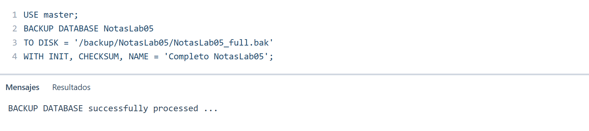

**Comprueba:** El comando finaliza correctamente y crea `NotasLab05_full.bak`. `INIT` reemplaza los conjuntos de respaldo del archivo elegido; `CHECKSUM` agrega comprobaciones de integridad; `NAME` identifica el respaldo.

### Agregar las calificaciones 7 y 8

Continúa en la misma pestaña de consulta de **SQL Server Management Studio**. Sustituye el código anterior por el bloque siguiente y pulsa **Ejecutar** o **F5**.

Estos cambios se producen después del completo.

**Qué hace el código:** `INSERT INTO` agrega dos nuevas calificaciones. `SELECT COUNT(*)` cuenta todas las filas de la tabla y `AS total_filas` pone un nombre a la columna del resultado. La consulta permite confirmar que el cambio ocurrió después del respaldo completo.

<!-- lab-step: 06 -->
```sql
USE NotasLab05;
INSERT INTO dbo.Calificacion VALUES
(7, N'Valeria Castillo', 9.00), (8, N'Mario Flores', 6.25);
SELECT COUNT(*) AS total_filas FROM dbo.Calificacion;
```

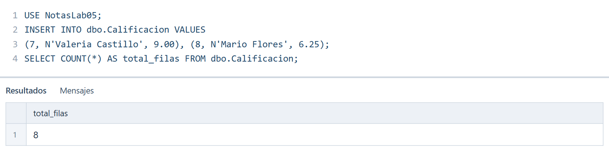

**Comprueba:** El total es **8**.

### Tomar el respaldo diferencial

Continúa en la misma pestaña de consulta de **SQL Server Management Studio**. Sustituye el código anterior por el bloque siguiente y pulsa **Ejecutar** o **F5**.

El diferencial conserva cambios desde el completo del apartado **Tomar el respaldo completo**. No depende de otro diferencial.

**Qué hace el código:** `BACKUP DATABASE ... WITH DIFFERENTIAL` crea un respaldo de las extensiones de datos modificadas desde el completo que sirve como base. Una extensión es un grupo de páginas donde SQL Server almacena datos. Aquí conserva los cambios que agregaron las calificaciones 7 y 8. `TO DISK` guarda el archivo diferencial y las opciones `INIT`, `CHECKSUM` y `NAME` cumplen la misma función que en el completo.

Revisa la pestaña **Mensajes**: esta operación no devuelve una tabla de datos.

<!-- lab-step: 07 -->
```sql
USE master;
BACKUP DATABASE NotasLab05
TO DISK = '/backup/NotasLab05/NotasLab05_diff.bak'
WITH DIFFERENTIAL, INIT, CHECKSUM, NAME = 'Diferencial NotasLab05';
```

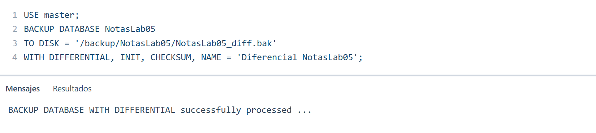

**Comprueba:** El comando finaliza correctamente. Este diferencial incluye los cambios que agregaron las filas 7 y 8, junto con las extensiones modificadas correspondientes.

### Agregar la calificación 9 y corregir una nota

Continúa en la misma pestaña de consulta de **SQL Server Management Studio**. Sustituye el código anterior por el bloque siguiente y pulsa **Ejecutar** o **F5**.

Agrega una fila y cambia la nota de Luis de 6.75 a 7.25.

**Qué hace el código:** `INSERT INTO` agrega la calificación 9. `UPDATE` modifica un dato existente; `SET nota = 7.25` fija el nuevo valor y `WHERE calificacion_id = 2` limita el cambio a Luis. La consulta final devuelve el total de filas y, mediante una consulta interna entre paréntesis, la nota del identificador 2. `AS nota_2` es el nombre que verá esa columna en el resultado.

<!-- lab-step: 08 -->
```sql
USE NotasLab05;
INSERT INTO dbo.Calificacion VALUES (9, N'Lucía Morales', 8.75);
UPDATE dbo.Calificacion SET nota = 7.25 WHERE calificacion_id = 2;
SELECT COUNT(*) AS total_filas,
       (SELECT nota FROM dbo.Calificacion WHERE calificacion_id = 2) AS nota_2
FROM dbo.Calificacion;
```

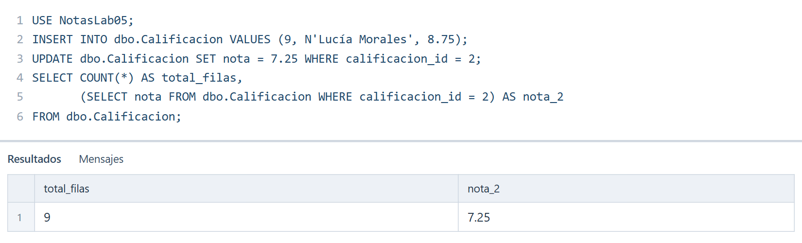

**Comprueba:** El total es **9** y `nota_2` es **7.25**.

### Respaldar el registro de transacciones

Continúa en la misma pestaña de consulta de **SQL Server Management Studio**. Sustituye el código anterior por el bloque siguiente y pulsa **Ejecutar** o **F5**.

Este es el primer respaldo del log de la base. Permite recuperar los cambios posteriores al diferencial.

**Qué hace el código:** `BACKUP LOG` guarda registros de transacciones, es decir, información sobre cambios realizados en la base. En este ejemplo permitirá recuperar la fila 9 y la corrección de Luis después de aplicar el diferencial. `TO DISK` guarda ese respaldo en el archivo `.trn`. Las opciones `INIT`, `CHECKSUM` y `NAME` preparan el archivo y describen el respaldo.

La confirmación aparece en **Mensajes**. Conserva este archivo junto al completo y al diferencial.

<!-- lab-step: 09 -->
```sql
USE master;
BACKUP LOG NotasLab05
TO DISK = '/backup/NotasLab05/NotasLab05_log.trn'
WITH INIT, CHECKSUM, NAME = 'Log NotasLab05';
```

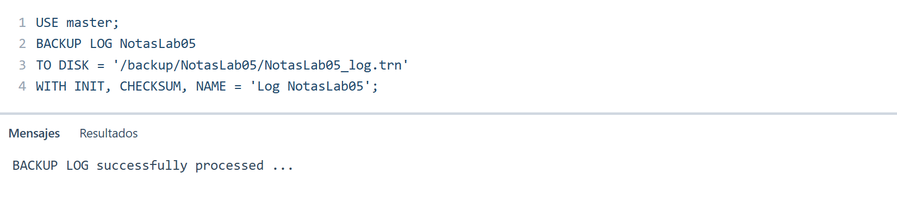

**Comprueba:** Se crea `NotasLab05_log.trn` sin errores. Incluye la información necesaria para recuperar la fila 9 y la corrección de la nota 2.

### Agregar un dato que quedará sin respaldo

Continúa en la misma pestaña de consulta de **SQL Server Management Studio**. Sustituye el código anterior por el bloque siguiente y pulsa **Ejecutar** o **F5**.

Agrega la última calificación. A partir de aquí no tomes otro respaldo antes de la falla simulada.

**Qué hace el código:** `INSERT INTO` agrega la calificación 10 y `COUNT(*)` comprueba que la tabla llega a diez filas. Como no tomaremos otro respaldo, esta fila permitirá observar la pérdida de un cambio posterior a la última copia disponible.

<!-- lab-step: 10 -->
```sql
USE NotasLab05;
INSERT INTO dbo.Calificacion VALUES (10, N'Andrés Guzmán', 7.50);
SELECT COUNT(*) AS total_filas FROM dbo.Calificacion;
```

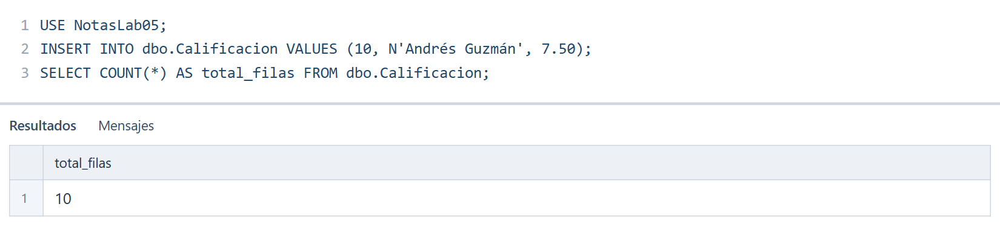

**Comprueba:** Hay **10** filas en la base actual, pero la fila 10 no está en los respaldos creados.

### Revisar los archivos creados

Cambia a la ventana de **PowerShell** que abriste al inicio. Copia el comando siguiente y presiona **Enter**. Los comandos que empiezan por `docker` se ejecutan en esa terminal.

Lista los nombres guardados en la carpeta del ejemplo.

**Qué hace el comando:** `docker exec` ejecuta `ls` dentro del contenedor. `ls -1` muestra un nombre de archivo por línea. Esto sirve para comprobar que los tres archivos de respaldo están en la carpeta esperada.

<!-- lab-step: 11 -->
```powershell
docker exec sqlserver-2025 ls -1 /backup/NotasLab05
```

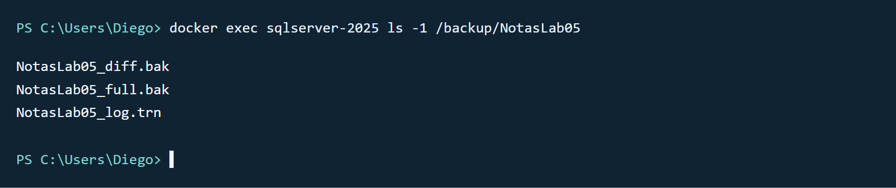

**Comprueba:** Están los tres archivos. Su existencia por sí sola no demuestra que permitan restaurar la base.

### Verificar que los respaldos son legibles

Regresa a **SQL Server Management Studio** y selecciona la pestaña de consulta que abriste para esta práctica. Sustituye el código anterior por el siguiente y pulsa **Ejecutar** o **F5**.

Verifica los tres archivos antes de simular la pérdida de la base.

**Qué hace el código:** `RESTORE VERIFYONLY` lee y verifica un respaldo sin restaurar la base. `FROM DISK` señala el archivo que debe revisar y `WITH CHECKSUM` exige comprobar sus sumas de verificación. Ejecutamos la instrucción para cada uno de los tres archivos. Busca tres mensajes de validación correcta antes de continuar.

<!-- lab-step: 12 -->
```sql
USE master;
RESTORE VERIFYONLY FROM DISK = '/backup/NotasLab05/NotasLab05_full.bak' WITH CHECKSUM;
RESTORE VERIFYONLY FROM DISK = '/backup/NotasLab05/NotasLab05_diff.bak' WITH CHECKSUM;
RESTORE VERIFYONLY FROM DISK = '/backup/NotasLab05/NotasLab05_log.trn' WITH CHECKSUM;
```

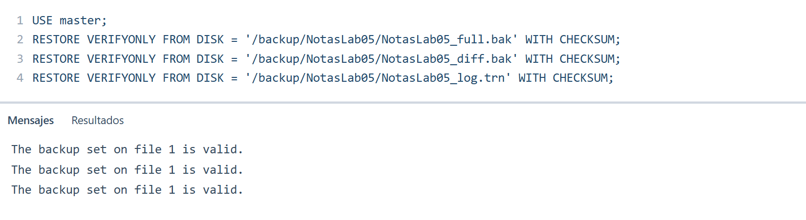

**Comprueba:** Las tres verificaciones terminan sin errores. Si una falla, no continúes con la eliminación. `VERIFYONLY` comprueba el conjunto y su legibilidad, pero no reemplaza restaurar y revisar los datos.

## Restaurar la base
Duration: 12


Trabaja desde `master` y cierra otras consultas conectadas a `NotasLab05`. El apartado **Simular la pérdida de la base** elimina únicamente la base de práctica; los archivos de respaldo permanecen en `/backup/NotasLab05`.

Para relacionar la prueba con el RTO, fija antes un objetivo didáctico de **10 minutos**. Inicia un cronómetro justo antes del apartado **Restaurar el completo** y detenlo cuando termine el apartado **Comprobar los datos recuperados**. Anota que esta medición incluye las pausas entre pasos y no constituye una medición de rendimiento del motor.

### Simular la pérdida de la base

Continúa en la misma pestaña de consulta de **SQL Server Management Studio**. Sustituye el código anterior por el bloque siguiente y pulsa **Ejecutar** o **F5**.

Continúa solo después de las tres verificaciones correctas del apartado **Verificar que los respaldos son legibles**.

**Qué hace el código:** `USE master` cambia la conexión de esta consulta a la base de administración. `DROP DATABASE` elimina `NotasLab05` y sus archivos de datos y log; en esta actividad representa la falla. Los respaldos guardados en `/backup` permanecen. `DB_ID` consulta si la base existe: después de eliminarla devuelve `NULL`, que indica que no se encontró un identificador para ese nombre.

<!-- lab-step: 13 -->
```sql
USE master;
DROP DATABASE NotasLab05;
SELECT DB_ID(N'NotasLab05') AS base_existente;
```

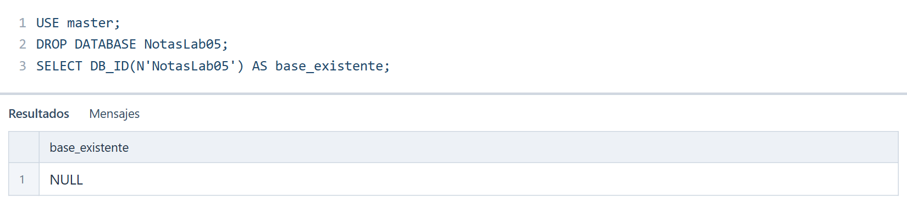

**Comprueba:** `base_existente` es **NULL**. Si indica que la base está en uso, cierra las otras consultas conectadas a ella y repite este paso.

### Restaurar el completo

Continúa en la misma pestaña de consulta de **SQL Server Management Studio**. Sustituye el código anterior por el bloque siguiente y pulsa **Ejecutar** o **F5**.

Aplica el siguiente respaldo de la cadena.

**Qué hace el código:** `RESTORE DATABASE` reconstruye la base a partir del archivo indicado en `FROM DISK`. `WITH NORECOVERY` la deja sin abrir para poder aplicar el respaldo diferencial y el log después. La consulta a `sys.databases` confirma el estado `RESTORING`, que significa que la restauración sigue pendiente.

<!-- lab-step: 14 -->
```sql
USE master;
RESTORE DATABASE NotasLab05
FROM DISK = '/backup/NotasLab05/NotasLab05_full.bak'
WITH NORECOVERY;
SELECT name, state_desc FROM sys.databases WHERE name = N'NotasLab05';
```


**Comprueba:** La base queda en **RESTORING**. `NORECOVERY` la mantiene pendiente de los respaldos siguientes; todavía no debes consultar su tabla.

### Restaurar el diferencial

Continúa en la misma pestaña de consulta de **SQL Server Management Studio**. Sustituye el código anterior por el bloque siguiente y pulsa **Ejecutar** o **F5**.

Aplica el siguiente respaldo de la cadena.

**Qué hace el código:** esta vez `RESTORE DATABASE` aplica el archivo diferencial sobre el completo ya restaurado. Agrega los cambios respaldados que incluyen las filas 7 y 8. Se mantiene `NORECOVERY` porque todavía falta aplicar el log. La consulta de estado debe seguir mostrando `RESTORING`.

<!-- lab-step: 15 -->
```sql
USE master;
RESTORE DATABASE NotasLab05
FROM DISK = '/backup/NotasLab05/NotasLab05_diff.bak'
WITH NORECOVERY;
SELECT name, state_desc FROM sys.databases WHERE name = N'NotasLab05';
```

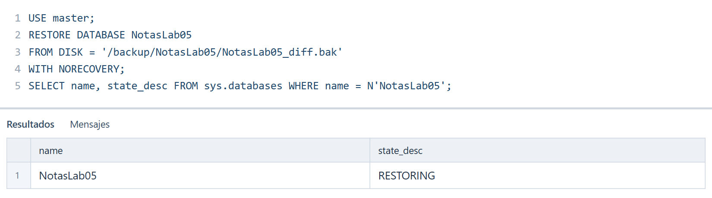

**Comprueba:** La base queda en **RESTORING**. `NORECOVERY` la mantiene pendiente de los respaldos siguientes; todavía no debes consultar su tabla.

### Restaurar el log

Continúa en la misma pestaña de consulta de **SQL Server Management Studio**. Sustituye el código anterior por el bloque siguiente y pulsa **Ejecutar** o **F5**.

Aplica el siguiente respaldo de la cadena.

**Qué hace el código:** `RESTORE LOG` aplica las transacciones conservadas en el archivo `.trn`. `WITH RECOVERY` finaliza la recuperación y deja la base disponible para consultas. La consulta a `sys.databases` debe mostrar `ONLINE`. En este momento se recuperan también la fila 9 y la nota de Luis corregida.

<!-- lab-step: 16 -->
```sql
USE master;
RESTORE LOG NotasLab05
FROM DISK = '/backup/NotasLab05/NotasLab05_log.trn'
WITH RECOVERY;
SELECT name, state_desc FROM sys.databases WHERE name = N'NotasLab05';
```

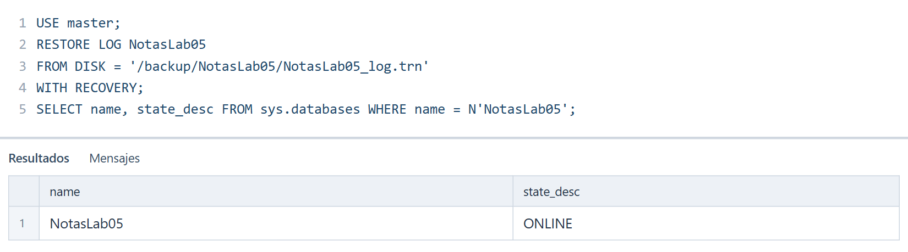

**Comprueba:** La base queda en **ONLINE**. Ya puedes consultar sus datos.

### Comprobar los datos recuperados

Continúa en la misma pestaña de consulta de **SQL Server Management Studio**. Sustituye el código anterior por el bloque siguiente y pulsa **Ejecutar** o **F5**.

Compara el resultado con la captura. Al terminar, detén el cronómetro.

**Qué hace el código:** `SELECT` muestra el identificador, nombre y nota de cada registro recuperado. `FROM` indica la tabla de origen y `ORDER BY calificacion_id` permite comparar las filas en el mismo orden que la captura. Esta consulta comprueba el contenido recuperado, además de que la base haya quedado disponible.

<!-- lab-step: 17 -->
```sql
USE NotasLab05;
SELECT calificacion_id, estudiante, nota
FROM dbo.Calificacion ORDER BY calificacion_id;
```

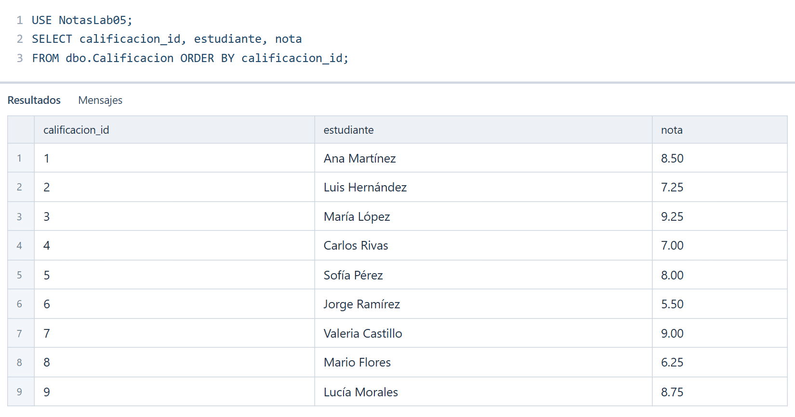

**Comprueba:** Hay **9 filas**, la nota 2 es **7.25** y no aparece el identificador 10.

### Interpretar lo ocurrido

La fila 10 representa un **dato perdido** porque se registró después del último respaldo disponible. No es el RPO: el RPO es un objetivo expresado en tiempo.

Para practicar la comparación, supón que el último respaldo cubría hasta las 14:00 y que la falla ocurrió a las 14:10. La ventana de pérdida sería de **10 minutos**. Frente a un RPO definido en **15 minutos**, cumpliría el objetivo. Estas horas son un supuesto didáctico y no se deducen de las nueve filas.

Compara el tiempo cronometrado con el objetivo didáctico de 10 minutos. Después de recuperar la base todavía corresponde verificar el funcionamiento del servicio, lo que en el esquema de clase se relaciona con el WRT.

## Respaldos lógicos
Duration: 10

### Generar scripts desde SSMS

En **SQL Server Management Studio**, ubica el panel izquierdo **Explorador de objetos** y despliega **Bases de datos**. Si `NotasLab05` no aparece, haz clic derecho en **Bases de datos** y selecciona **Actualizar**.

Haz clic derecho en `NotasLab05` y abre **Tareas → Generar scripts**. En el asistente, avanza hasta **Elegir objetos**, marca **Seleccionar objetos de base de datos específicos** y selecciona la tabla `dbo.Calificacion`.

En **Establecer opciones de scripting**, abre **Avanzadas** y cambia **Tipos de datos que se deben incluir en el script** a **Esquema y datos**. Acepta ese cambio, elige **Guardar como archivo de script**, selecciona una carpeta de tu PC y finaliza el asistente.

Abre el archivo guardado y comprueba que contiene `CREATE TABLE`, que permite reconstruir la estructura, e instrucciones `INSERT`, que permiten volver a agregar las filas. En esta actividad solo se genera y revisa el archivo; conserva la tabla actual para continuar con `bcp`.

### Recuperar la tabla con bcp

`bcp out` guarda los datos y `bcp in` los agrega a una tabla existente. El archivo nativo creado con `-n` es binario: no está pensado para abrirlo como texto ni conserva por sí solo la definición de la tabla.

La herramienta **bcp** (*Bulk Copy Program*) copia datos entre una tabla y un archivo. El entorno de clase utiliza su versión compatible con `-u`.

En los comandos siguientes, `-it` permite escribir la contraseña al solicitarse. Usa la contraseña de la cuenta `sa` de tu contenedor; al escribirla puede no aparecer en pantalla. `localhost` se refiere al servidor **dentro del contenedor**. `-u` permite confiar en su certificado de práctica.

### Exportar las nueve calificaciones

Cambia a la ventana de **PowerShell** que abriste al inicio. Copia el comando siguiente y presiona **Enter**. Los comandos que empiezan por `docker` se ejecutan en esa terminal.

Escribe la contraseña cuando aparezca la solicitud. Espera a que finalice la copia.

**Qué hace el comando:** `docker exec -it` abre una ejecución interactiva dentro del contenedor. La ruta `/opt/mssql-tools18/bin/bcp` identifica la herramienta de copia de datos. `NotasLab05.dbo.Calificacion` indica base, esquema y tabla. `out` exporta las filas al archivo `calificacion.dat`; `-n` usa formato nativo; `-S localhost` elige el servidor dentro del contenedor; `-U sa` indica el usuario y `-u` permite confiar en su certificado. Al omitir la contraseña del comando, la herramienta te la solicita.

<!-- lab-step: 18 -->
```powershell
docker exec -it sqlserver-2025 /opt/mssql-tools18/bin/bcp NotasLab05.dbo.Calificacion out /backup/NotasLab05/calificacion.dat -n -S localhost -U sa -u
```

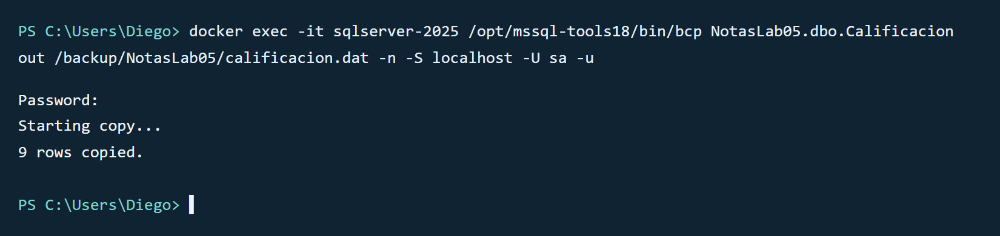

**Comprueba:** La salida indica **9 rows copied**. Si falla la exportación, conserva la tabla y resuelve el error antes del paso siguiente.

### Vaciar la tabla de práctica

Regresa a **SQL Server Management Studio** y selecciona la pestaña de consulta que abriste para esta práctica. Sustituye el código anterior por el siguiente y pulsa **Ejecutar** o **F5**.

Simula la eliminación accidental de sus datos. Hazlo solo después de exportar las nueve filas.

**Qué hace el código:** `DELETE FROM dbo.Calificacion` elimina todas las filas porque no incluye una condición `WHERE`. La estructura de la tabla se conserva. `COUNT(*)` confirma que quedó vacía; esto prepara la importación sin repetir identificadores que ya existan.

<!-- lab-step: 19 -->
```sql
USE NotasLab05;
DELETE FROM dbo.Calificacion;
SELECT COUNT(*) AS total_filas FROM dbo.Calificacion;
```

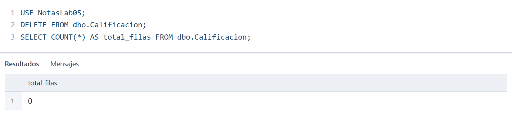

**Comprueba:** La tabla sigue existiendo, pero contiene **0** filas.

### Importar las calificaciones

Cambia a la ventana de **PowerShell** que abriste al inicio. Copia el comando siguiente y presiona **Enter**. Los comandos que empiezan por `docker` se ejecutan en esa terminal.

Escribe nuevamente la contraseña si la herramienta la solicita.

**Qué hace el comando:** `bcp ... in` lee el archivo exportado y agrega sus filas a la tabla indicada. `-n` debe coincidir con el formato usado en la exportación. `-S`, `-U` y `-u` vuelven a indicar el servidor, el usuario y la confianza en su certificado. La tabla debe existir y estar vacía antes de esta importación.

<!-- lab-step: 20 -->
```powershell
docker exec -it sqlserver-2025 /opt/mssql-tools18/bin/bcp NotasLab05.dbo.Calificacion in /backup/NotasLab05/calificacion.dat -n -S localhost -U sa -u
```

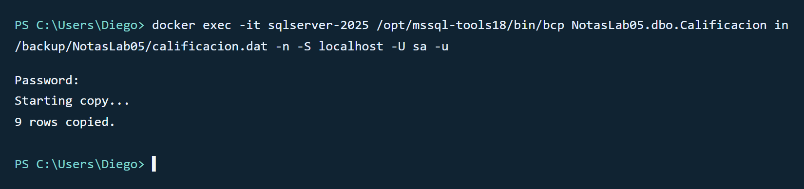

**Comprueba:** Se copian **9 filas**. Ejecuta la importación una sola vez: si las claves ya existen, la segunda importación produce un error.

### Comprobar la tabla importada

Regresa a **SQL Server Management Studio** y selecciona la pestaña de consulta que abriste para esta práctica. Sustituye el código anterior por el siguiente y pulsa **Ejecutar** o **F5**.

Verifica la cantidad y la nota que habías corregido.

**Qué hace el código:** `COUNT(*)` comprueba que regresaron las nueve filas. La consulta interna obtiene la nota de Luis por su identificador. Esta segunda comprobación confirma que se importaron los valores esperados, además de recuperar la cantidad de registros.

<!-- lab-step: 21 -->
```sql
USE NotasLab05;
SELECT COUNT(*) AS total_filas,
       (SELECT nota FROM dbo.Calificacion WHERE calificacion_id = 2) AS nota_2
FROM dbo.Calificacion;
```

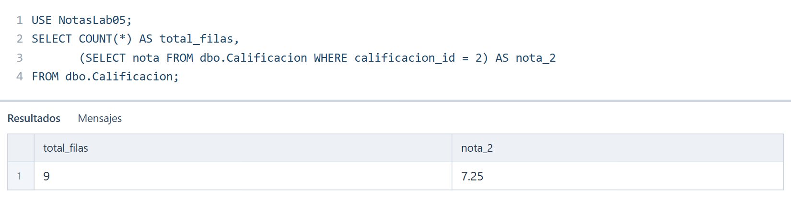

**Comprueba:** Vuelven a aparecer **9 filas** y la nota 2 conserva **7.25**.

### Exportar una consulta con sqlcmd

Cambia a la ventana de **PowerShell** que abriste al inicio. Copia el comando siguiente y presiona **Enter**. Los comandos que empiezan por `docker` se ejecutan en esa terminal.

Este ejemplo complementario crea un archivo de texto con los identificadores y notas. No recrea la tabla.

**Qué hace el comando:** `sqlcmd` ejecuta una consulta SQL desde la terminal. `-S` y `-U` indican el servidor y usuario; `-C` permite confiar en el certificado del servidor; `-d` selecciona `NotasLab05`; `-Q` contiene la consulta y termina al ejecutarla. Dentro de esa consulta, `SET NOCOUNT ON` evita agregar el mensaje de cantidad de filas afectadas. `-s ","` separa las columnas con comas, `-W` quita espacios al final de los valores, `-h -1` omite los encabezados y `-o` guarda el resultado en `notas.csv`. La herramienta pedirá la contraseña si no está disponible en su configuración.

<!-- lab-step: 22 -->
```powershell
docker exec -it sqlserver-2025 /opt/mssql-tools18/bin/sqlcmd -S localhost -U sa -C -d NotasLab05 -Q "SET NOCOUNT ON; SELECT calificacion_id, nota FROM dbo.Calificacion ORDER BY calificacion_id;" -s "," -W -h -1 -o /backup/NotasLab05/notas.csv
```

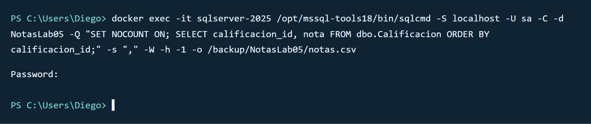

**Comprueba:** El comando termina sin error. Como `-o` envía la consulta al archivo, las filas no aparecen en la terminal. `-h -1` omite el encabezado y `-W` quita espacios finales.

### Leer el archivo exportado

Continúa en la misma ventana de **PowerShell**. Copia el bloque siguiente, presiona **Enter** y espera a que vuelva a aparecer el indicador `PS`.

Visualiza el contenido del archivo de texto.

**Qué hace el comando:** `cat` lee el archivo de texto y presenta su contenido en la terminal. Lo ejecutamos mediante `docker exec` porque el archivo está dentro del contenedor. Cada línea debe contener un identificador y una nota separados por una coma.

<!-- lab-step: 23 -->
```powershell
docker exec sqlserver-2025 cat /backup/NotasLab05/notas.csv
```

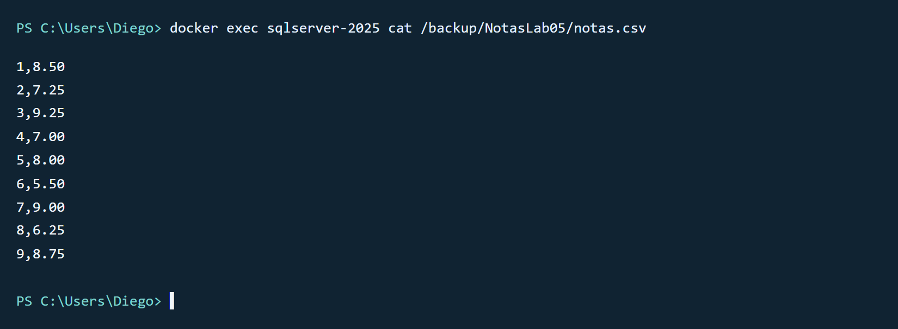

**Comprueba:** Aparecen nueve registros, incluido `2,7.25`. Este ejemplo solo contiene campos numéricos; exportar CSV con texto que incluya comas o saltos de línea requiere tratar esos caracteres.

## Respaldo automático
Duration: 12

**SQL Server Agent** es el servicio de SQL Server que ejecuta tareas de forma automática. Sirve para que una actividad, como crear un respaldo, se ejecute sin que una persona tenga que pegar el comando cada vez. Un **job** reúne acciones o **steps** y una **schedule** define cuándo ejecutarlas. Un **operator** recibe notificaciones. Una **alert** detecta eventos o condiciones del servidor: es distinta de la notificación de un job que termina con error.

Crearemos un respaldo completo diario. Para evitar confundir el horario, el ejemplo usa un servidor en **UTC** y programa las **04:00 UTC**, equivalentes a las **10:00 p. m. del día anterior en El Salvador**. Al ser una programación diaria, se ejecutará cada noche local.

El job conserva un solo archivo de demostración y lo sobrescribe con `INIT`. Una estrategia de producción debe definir retención y la programación de todos los tipos de respaldo necesarios.

### Comprobar Agent y el horario del servidor

Regresa a **SQL Server Management Studio** y selecciona la pestaña de consulta que abriste para esta práctica. Sustituye el código anterior por el siguiente y pulsa **Ejecutar** o **F5**.

La cuenta debe poder consultar el estado de los servicios.

**Qué hace el código:** `sys.dm_server_services` contiene información de los servicios de SQL Server. `WHERE ... LIKE` filtra el servicio cuyo nombre empieza por `SQL Server Agent`; `%` representa el resto del nombre. `SYSDATETIMEOFFSET()` obtiene la fecha y hora del servidor con su desfase horario y `DATEPART(TZOFFSET, ...)` extrae ese desfase en minutos. La consulta sirve para comprobar que Agent está activo y elegir la hora correcta de programación.

<!-- lab-step: 24 -->
```sql
USE master;
SELECT servicename, status_desc,
       DATEPART(TZOFFSET, SYSDATETIMEOFFSET()) AS desfase_utc_minutos
FROM sys.dm_server_services
WHERE servicename LIKE N'SQL Server Agent%';
```

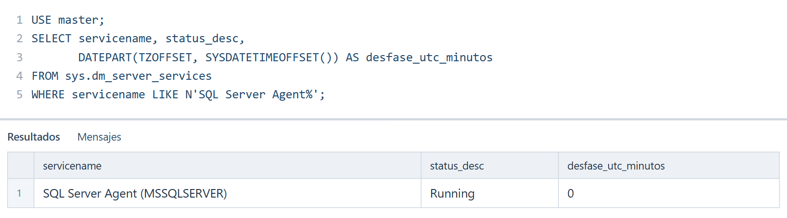

**Comprueba:** Agent aparece **Running**. Un desfase **0** corresponde a UTC y permite usar la programación del apartado **Asignar la programación diaria**. Si aparece **-360**, el servidor está en hora de El Salvador: en ese paso usa `220000` en lugar de `040000`. Si Agent no está activo o el desfase es otro, consulta al instructor.

### Crear el trabajo y su acción

Continúa en la misma pestaña de consulta de **SQL Server Management Studio**. Sustituye el código anterior por el bloque siguiente y pulsa **Ejecutar** o **F5**.

Ejecuta una vez. La acción respalda la base en un archivo diferente a los usados para restaurar.

**Qué hace el código:** `USE msdb` selecciona la base que guarda los trabajos de Agent. `IF EXISTS` comprueba si ya hay un trabajo con ese nombre; `THROW` detiene este bloque si existe. Las instrucciones que empiezan por `sp_` son procedimientos almacenados del sistema y `EXEC` los ejecuta.

* `sp_add_job` crea el trabajo; `@job_name` establece su nombre.
* `sp_add_jobstep` agrega la acción. `@step_name` la identifica; `@subsystem = N'TSQL'` indica que ejecutará SQL; `@database_name` establece el contexto y `@command` contiene el respaldo que se ejecutará. Las comillas duplicadas permiten incluir la ruta dentro de ese texto.
* `sp_add_jobserver` asigna el trabajo al servidor local para que Agent pueda ejecutarlo.
* `COMPRESSION` reduce el tamaño del respaldo. La consulta final a `sysjobs` comprueba que el trabajo quedó creado y habilitado.

<!-- lab-step: 25 -->
```sql
USE msdb;
IF EXISTS (SELECT 1 FROM dbo.sysjobs WHERE name = N'Respaldo diario NotasLab05')
    THROW 50002, N'El job ya existe. No lo crees otra vez.', 1;
EXEC dbo.sp_add_job @job_name = N'Respaldo diario NotasLab05';
EXEC dbo.sp_add_jobstep
    @job_name = N'Respaldo diario NotasLab05',
    @step_name = N'Respaldo completo',
    @subsystem = N'TSQL', @database_name = N'master',
    @command = N'BACKUP DATABASE NotasLab05
TO DISK = ''/backup/NotasLab05/NotasLab05_job.bak''
WITH INIT, CHECKSUM, COMPRESSION;';
EXEC dbo.sp_add_jobserver @job_name = N'Respaldo diario NotasLab05';
SELECT name, enabled FROM dbo.sysjobs WHERE name = N'Respaldo diario NotasLab05';
```

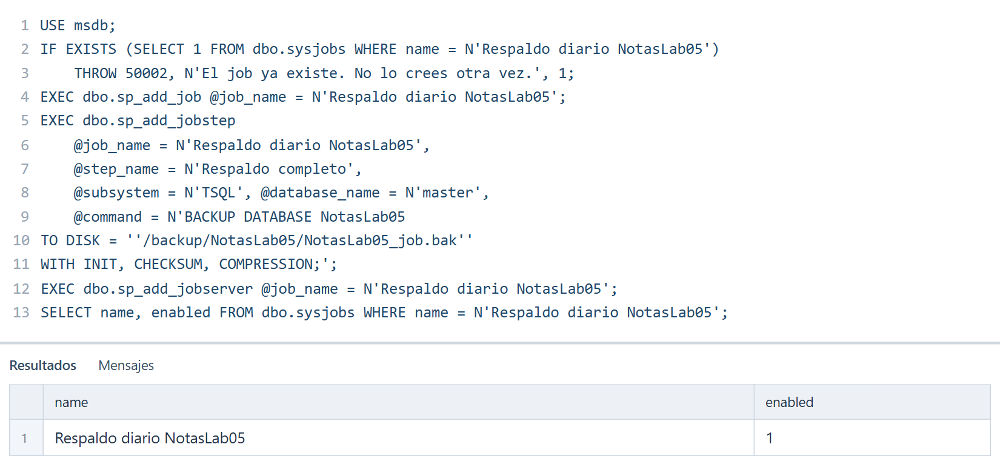

**Comprueba:** El job aparece con **enabled = 1**. `COMPRESSION` comprime el respaldo y está disponible en la edición Developer utilizada en clase.

### Asignar la programación diaria

Continúa en la misma pestaña de consulta de **SQL Server Management Studio**. Sustituye el código anterior por el bloque siguiente y pulsa **Ejecutar** o **F5**.

Este bloque corresponde a un servidor en UTC, comprobado en el apartado **Comprobar Agent y el horario del servidor**. Si el desfase fue -360, cambia únicamente `040000` por `220000`.

**Qué hace el código:** `sp_add_schedule` crea un horario. `@schedule_name` le da un nombre, `@freq_type = 4` significa frecuencia diaria y `@freq_interval = 1` significa cada día. `@active_start_time` usa el formato HHMMSS: `040000` representa las 04:00 del servidor. `sp_attach_schedule` asocia ese horario al trabajo. La consulta a `sysschedules` permite revisar los valores que quedaron guardados.

<!-- lab-step: 26 -->
```sql
USE msdb;
EXEC dbo.sp_add_schedule
    @schedule_name = N'NotasLab05_diario_22h_SV',
    @freq_type = 4, @freq_interval = 1,
    @active_start_time = 040000;
EXEC dbo.sp_attach_schedule
    @job_name = N'Respaldo diario NotasLab05',
    @schedule_name = N'NotasLab05_diario_22h_SV';
SELECT name, freq_type, freq_interval, active_start_time
FROM dbo.sysschedules WHERE name = N'NotasLab05_diario_22h_SV';
```

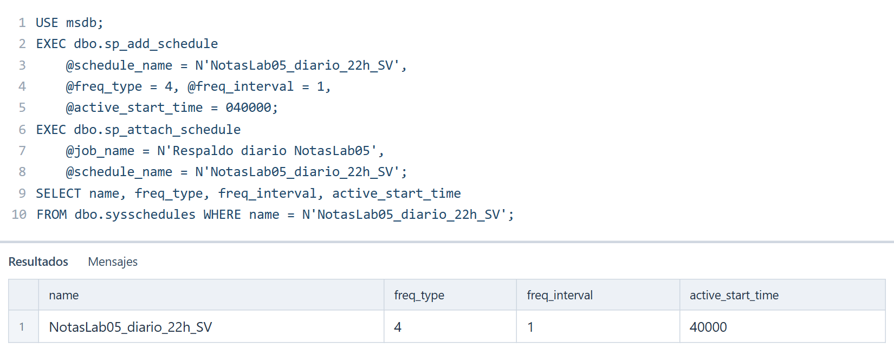

**Comprueba:** `freq_type = 4` y `freq_interval = 1` indican todos los días. En UTC, el valor guardado es **40000**: la columna numérica no muestra el cero inicial de `040000`.

### Ejecutar el job ahora

Continúa en la misma pestaña de consulta de **SQL Server Management Studio**. Sustituye el código anterior por el bloque siguiente y pulsa **Ejecutar** o **F5**.

No es necesario esperar a la hora programada.

**Qué hace el código:** `sp_start_job` solicita a SQL Server Agent que inicie el trabajo indicado en `@job_name`. La ejecución ocurre en segundo plano: recuperar el control de la ventana de consulta no garantiza que el respaldo ya haya terminado. El mensaje confirma que se aceptó el inicio.

<!-- lab-step: 27 -->
```sql
EXEC msdb.dbo.sp_start_job @job_name = N'Respaldo diario NotasLab05';
```

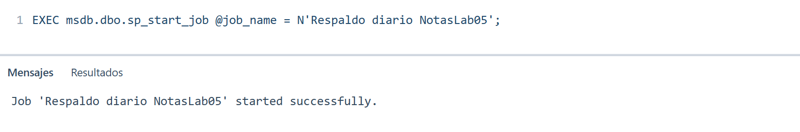

**Comprueba:** El mensaje confirma el inicio, no el éxito final. Consulta el historial en el siguiente paso.

### Comprobar el resultado del job

Continúa en la misma pestaña de consulta de **SQL Server Management Studio**. Sustituye el código anterior por el bloque siguiente y pulsa **Ejecutar** o **F5**.

Espera unos segundos y consulta la última ejecución completa. Si no aparecen filas, vuelve a ejecutar esta consulta.

**Qué hace el código:** `sysjobhistory` guarda el historial y `sysjobs` guarda los nombres de los trabajos. `JOIN ... ON` relaciona ambas tablas por `job_id`. `WHERE` selecciona este trabajo y `step_id = 0` corresponde al resultado global de la ejecución. `ORDER BY instance_id DESC` coloca primero el registro más reciente y `TOP (1)` devuelve solo ese registro. `CASE` traduce el código de estado a un texto fácil de interpretar.

<!-- lab-step: 28 -->
```sql
SELECT TOP (1) j.name AS trabajo, h.run_status,
       CASE h.run_status WHEN 1 THEN N'Correcto'
            WHEN 0 THEN N'Falló' ELSE N'Revisar historial' END AS resultado
FROM msdb.dbo.sysjobhistory AS h
JOIN msdb.dbo.sysjobs AS j ON j.job_id = h.job_id
WHERE j.name = N'Respaldo diario NotasLab05' AND h.step_id = 0
ORDER BY h.instance_id DESC;
```

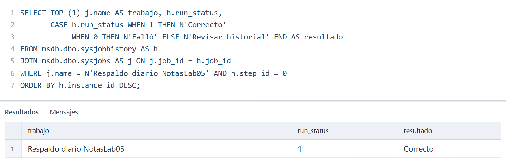

**Comprueba:** El resultado final es **run_status = 1 / Correcto**. Si es 0, abre **Agente SQL Server → Trabajos → Ver historial** y revisa el mensaje de error.

## Notificaciones
Duration: 6

La clase pide notificar a un operador cuando falle el respaldo. Usaremos el nombre **operador_NotasLab05** para identificar el operador de este ejemplo y evitar reutilizar `operador1` de otra práctica.

**Database Mail** es la función de SQL Server que envía mensajes de correo. Una cuenta **SMTP** describe el servidor de correo saliente y un **perfil** agrupa la configuración que se usará para enviarlos. Para entregar correos se necesitan: Database Mail habilitado, una cuenta SMTP y un perfil configurados, el perfil registrado en SQL Agent y un destino de correo accesible. Las diapositivas 10 y 11 de **22_SQL Agent** muestran esa preparación. En el entorno de clase puede usarse **Mailpit**, una herramienta que recibe mensajes de prueba y permite verlos en una bandeja local; el instructor debe confirmar sus datos y cómo abrir su bandeja.

En Linux, el perfil del Agent se configura mediante `sqlagent.databasemailprofile` o `MSSQL_AGENT_EMAIL_PROFILE`. El nombre debe coincidir con un perfil existente. Crear un operador y seleccionarlo en el job **no configura por sí solo el correo**.

### Consultar los perfiles de correo

Continúa en la misma pestaña de consulta de **SQL Server Management Studio**. Sustituye el código anterior por el bloque siguiente y pulsa **Ejecutar** o **F5**.

Esta comprobación ayuda a identificar si falta la preparación del correo.

**Qué hace el código:** `sysmail_profile` guarda los perfiles de Database Mail. `SELECT name AS perfil` muestra su nombre con el encabezado `perfil` y `ORDER BY` lo ordena. Un perfil reúne la configuración que SQL Server utiliza para enviar correo; encontrar su nombre es una comprobación inicial, pero no demuestra que el envío funcione.

<!-- lab-step: 29 -->
```sql
SELECT name AS perfil FROM msdb.dbo.sysmail_profile ORDER BY name;
```

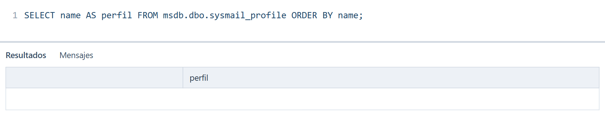

**Comprueba:** Si no aparecen filas, falta crear un perfil. Si aparece alguno, todavía hay que comprobar su cuenta SMTP, su selección en Agent y una prueba de recepción con el instructor. La captura ilustra el caso sin perfiles.

### Asociar el operador al job

Continúa en la misma pestaña de consulta de **SQL Server Management Studio**. Sustituye el código anterior por el bloque siguiente y pulsa **Ejecutar** o **F5**.

El correo `.local` es un destino ilustrativo para un capturador de correo del laboratorio. Sustitúyelo por el destino indicado por el instructor. Puedes configurar la asociación aunque todavía falte el transporte de correo.

**Qué hace el código:** `IF NOT EXISTS` comprueba si el operador ya fue creado. `sp_add_operator` registra el nombre y la dirección del destinatario. `sp_update_job` modifica el trabajo: `@notify_level_email = 2` solicita notificar cuando falle y `@notify_email_operator_name` elige a quién notificar. La consulta final une `sysjobs` con `sysoperators` para mostrar la asociación guardada.

<!-- lab-step: 30 -->
```sql
USE msdb;
IF NOT EXISTS (SELECT 1 FROM dbo.sysoperators WHERE name = N'operador_NotasLab05')
    EXEC dbo.sp_add_operator
        @name = N'operador_NotasLab05',
        @email_address = N'operador@notaslab05.local';
EXEC dbo.sp_update_job
    @job_name = N'Respaldo diario NotasLab05',
    @notify_level_email = 2,
    @notify_email_operator_name = N'operador_NotasLab05';
SELECT j.name AS trabajo, j.notify_level_email, o.name AS operador
FROM dbo.sysjobs AS j
JOIN dbo.sysoperators AS o ON o.id = j.notify_email_operator_id
WHERE j.name = N'Respaldo diario NotasLab05';
```

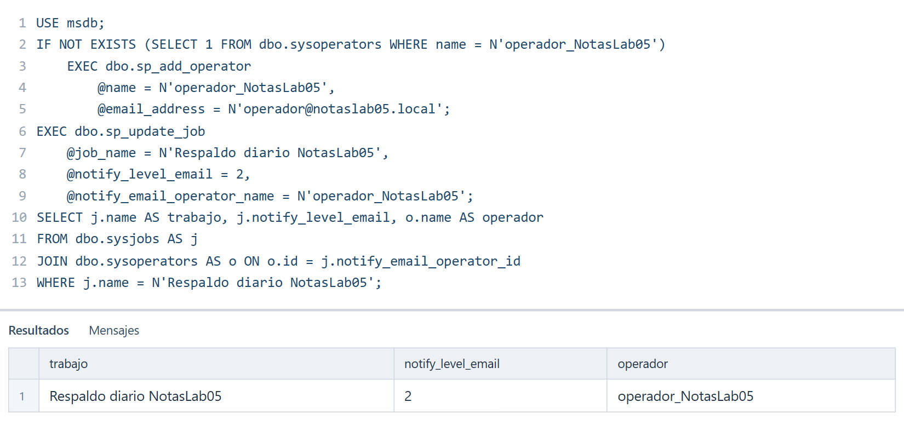

**Comprueba:** `notify_level_email = 2` indica notificar por fallo y el operador está asociado. Esta cuadrícula **no demuestra que un correo haya sido entregado**. Si el operador ya existía, revisa su dirección en SSMS antes de una prueba.

Para comprobar recepción, completa con el instructor la preparación de Database Mail y una prueba controlada de notificación en el entorno de clase. Registra por separado **asociación configurada** y **correo recibido**; si no hay transporte de correo disponible, esta última comprobación queda pendiente.

## Limpieza
Duration: 5

### Evidencias del ejemplo guiado

Conserva tus propias capturas de estos resultados antes de limpiar:

* Tres respaldos legibles y estados de restauración `RESTORING`, `RESTORING`, `ONLINE`.
* Nueve filas recuperadas, nota 2 igual a 7.25 y ausencia de la fila 10.
* Tabla vacía después del borrado y nueve filas después de `bcp in`.
* Historial del job correcto y asociación de la notificación.

Anota el tiempo de tu recuperación y compáralo con el objetivo didáctico. Explica por qué la cantidad de archivos no es el RTO y por qué una fila perdida no es el RPO.

El **ejercicio evaluado** y sus criterios los proporciona el instructor. Esta secuencia es el ejemplo guiado para prepararlo.

### Limpieza opcional

Ejecuta los pasos siguientes solo al terminar y después de guardar las evidencias. Eliminan los objetos y archivos del ejemplo. Cierra las consultas conectadas a `NotasLab05` y asegúrate de que su job no está ejecutándose.

### Eliminar los objetos del ejemplo

Continúa en la misma pestaña de consulta de **SQL Server Management Studio**. Sustituye el código anterior por el bloque siguiente y pulsa **Ejecutar** o **F5**.

Este bloque permite preparar una nueva práctica desde cero.

**Qué hace el código:** `sp_delete_job` elimina el trabajo y `@delete_unused_schedule = 1` elimina su horario si ya no lo usa otro trabajo. `sp_delete_operator` elimina el operador del ejemplo. `sp_delete_database_backuphistory` borra su historial de respaldos, pero no los archivos `.bak` y `.trn`. Después de cambiar a `master`, `DROP DATABASE` elimina la base de práctica. Las condiciones `IF EXISTS` evitan intentar eliminar objetos que ya no están. La consulta final debe devolver `NULL`.

<!-- lab-step: 31 -->
```sql
-- LIMPIEZA OPCIONAL
USE msdb;
IF EXISTS (SELECT 1 FROM dbo.sysjobs WHERE name = N'Respaldo diario NotasLab05')
    EXEC dbo.sp_delete_job @job_name = N'Respaldo diario NotasLab05', @delete_unused_schedule = 1;
IF EXISTS (SELECT 1 FROM dbo.sysoperators WHERE name = N'operador_NotasLab05')
    EXEC dbo.sp_delete_operator @name = N'operador_NotasLab05';
EXEC dbo.sp_delete_database_backuphistory @database_name = N'NotasLab05';
USE master;
IF DB_ID(N'NotasLab05') IS NOT NULL DROP DATABASE NotasLab05;
SELECT DB_ID(N'NotasLab05') AS base_existente;
```

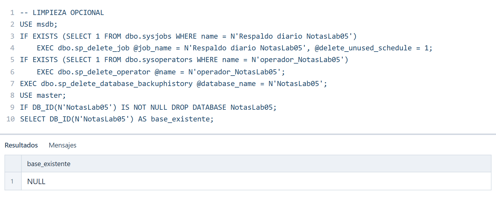

**Comprueba:** `base_existente` es **NULL** y el job del ejemplo desaparece de la lista de trabajos.

### Eliminar los archivos del ejemplo

Cambia a la ventana de **PowerShell** que abriste al inicio. Copia el comando siguiente y presiona **Enter**. Los comandos que empiezan por `docker` se ejecutan en esa terminal.

Borra únicamente los seis archivos usados en esta guía y luego intenta retirar la carpeta vacía.

**Qué hacen los comandos:** `rm -f` elimina los archivos concretos indicados en la carpeta del ejemplo y omite errores si alguno ya no existe. `rmdir` elimina la carpeta únicamente si quedó vacía. Ambos comandos se ejecutan dentro del contenedor mediante `docker exec`; su propósito es dejar el entorno listo para repetir la práctica.

<!-- lab-step: 32 -->
```powershell
docker exec sqlserver-2025 rm -f /backup/NotasLab05/NotasLab05_full.bak /backup/NotasLab05/NotasLab05_diff.bak /backup/NotasLab05/NotasLab05_log.trn /backup/NotasLab05/NotasLab05_job.bak /backup/NotasLab05/calificacion.dat /backup/NotasLab05/notas.csv
docker exec sqlserver-2025 rmdir /backup/NotasLab05
```

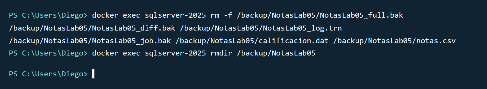

**Comprueba:** Ambos comandos vuelven al indicador de PowerShell sin error. Si `rmdir` dice que la carpeta no está vacía, conserva los archivos adicionales y revísalos con el instructor.

## Créditos
Duration: 0

Departamento de Electrónica e Informática, Universidad Centroamericana José Simeón Cañas, La Libertad, El Salvador.

| Versión | Autor | Ciclo |
| --- | --- | --- |
| 1 | Diego Eduardo Castro Quintanilla (00117322@uca.edu.sv) | 02-2025 |
| 2 | Diego Eduardo Castro Quintanilla (00117322@uca.edu.sv) | 02-2026 |

Material de clase: **23_Copias de serguridad.pptx**, para objetivos de recuperación y respaldos; **22_SQL Agent.pptx**, para trabajos, programaciones, operadores y correo.

Referencias técnicas para las precisiones de esta versión:

* [Respaldar el registro de transacciones](https://learn.microsoft.com/en-us/sql/relational-databases/backup-restore/back-up-a-transaction-log-sql-server?view=sql-server-ver17).
* [RESTORE VERIFYONLY y sus límites](https://learn.microsoft.com/en-us/sql/t-sql/statements/restore-statements-verifyonly-transact-sql?view=sql-server-ver17).
* [Database Mail y SQL Agent en Linux](https://learn.microsoft.com/en-us/sql/linux/sql-server-linux-db-mail-sql-agent?view=sql-server-ver17).
* [Utilidad bcp](https://learn.microsoft.com/en-us/sql/tools/bcp-utility?view=sql-server-ver17).

Los datos de las calificaciones son ficticios y se utilizan con fines educativos.


Este trabajo se distribuye bajo la licencia [Creative Commons Atribución-NoComercial-CompartirIgual 4.0 Internacional](https://creativecommons.org/licenses/by-nc-sa/4.0/).

