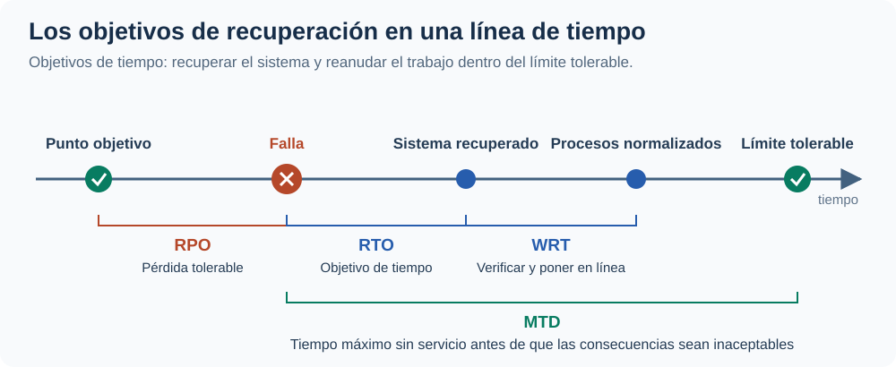
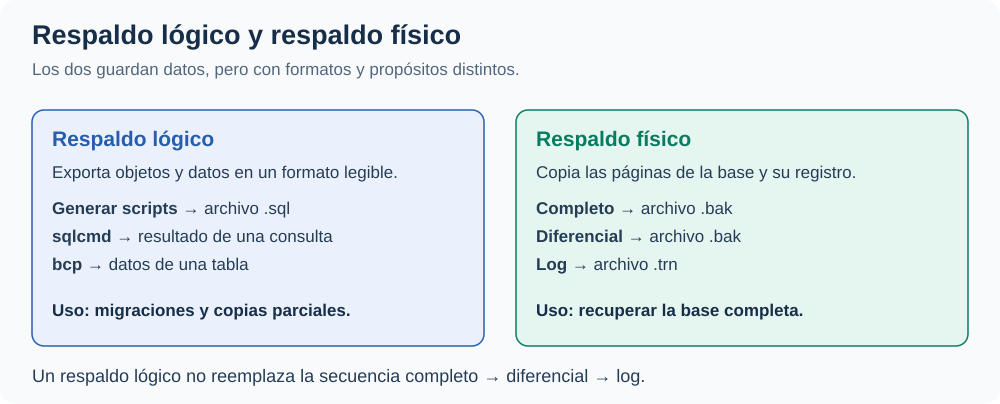
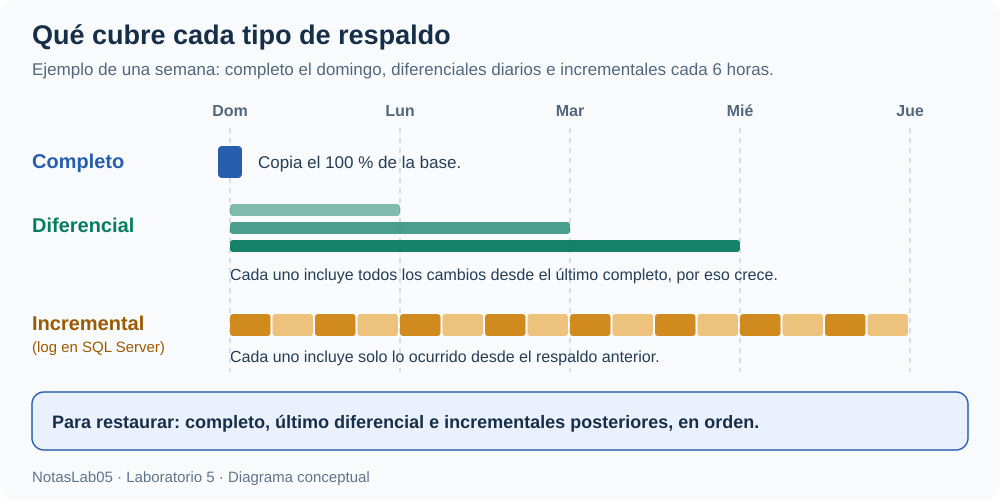
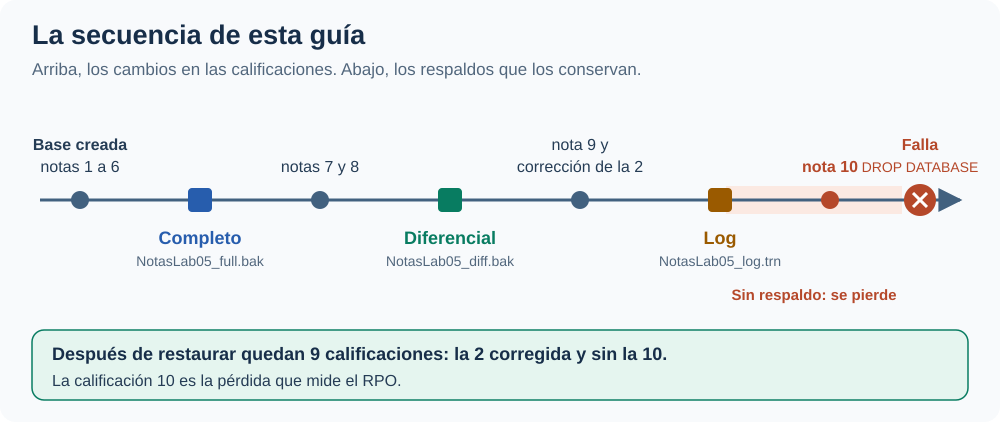
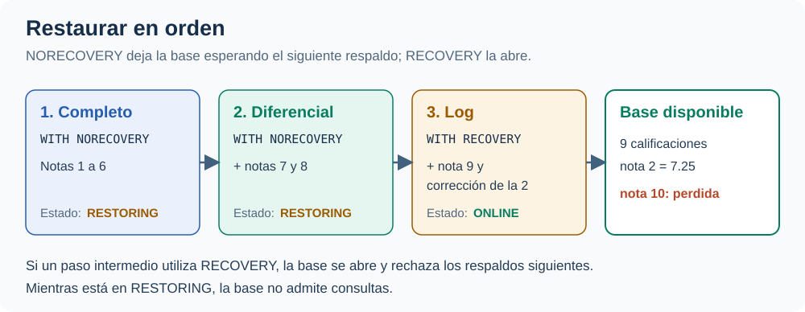
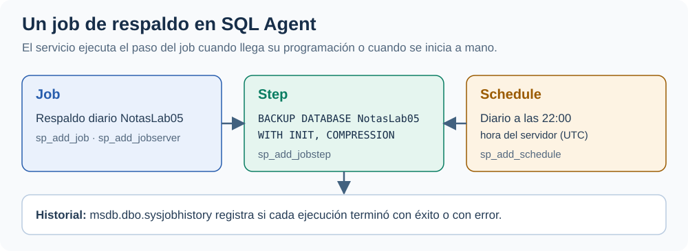

author: Diego Eduardo Castro Quintanilla
summary: Guía informativa de copias de seguridad en SQL Server con un ejemplo corto sobre NotasLab05: objetivos de recuperación, tipos de respaldo, restauración, respaldos lógicos y SQL Agent. Ciclo 02-2026, versión 1.
id: g05
categories: databases
environments: Web
status: Published

# Laboratorio 5 — Copias de seguridad en SQL Server

## Introducción
Duration: 5

Esta guía resume los contenidos de clase sobre **copias de seguridad y restauración en SQL Server**. El ejemplo utiliza `NotasLab05`, una base con calificaciones ficticias, para respaldarla, simular una falla y restaurarla.

El propósito es **comprender los conceptos y la función de los comandos**. El ejercicio práctico se desarrolla por separado, según las indicaciones del instructor.

### Objetivo general

**Aplicar una estrategia de copias de seguridad en SQL Server** mediante respaldos completos, diferenciales y del registro de transacciones sobre `NotasLab05`, **para restaurar la base después de una falla y relacionar los datos recuperados con los objetivos de recuperación RPO y RTO**.

### Objetivos específicos

* **Explicar los objetivos de recuperación RPO, RTO, WRT y MTD** y su relación con la estrategia de respaldo.
* **Distinguir los respaldos lógicos de los físicos** y los tipos completo, diferencial e incremental.
* **Respaldar y restaurar una base** con `BACKUP` y `RESTORE`, aplicando los respaldos en orden.
* **Programar un respaldo** con un job de SQL Agent.

### Por qué respaldar

En clase se revisaron tres incidentes: Pixar perdió gran parte de los archivos de *Toy Story 2* por un `rm -rf` accidental (1998), GitLab borró por error su base de producción y perdió 6 horas de datos (2017), y Myspace perdió las canciones subidas durante 12 años en una migración de servidores (2019). En los tres casos **el respaldo no funcionaba, estaba desactualizado o no existía**.

> **Idea clave:** sin verificación, un respaldo es como no tenerlo. Un plan que no se ha probado es un plan que no existe.

## Objetivos de recuperación
Duration: 8

Un **plan de contingencia** define cuánto tiempo puede estar detenido un servicio y cuántos datos puede perder:

| Sigla | Nombre | Qué mide |
| --- | --- | --- |
| **RPO** | *Recovery Point Objective* | Máxima pérdida de datos tolerable, medida en tiempo. |
| **RTO** | *Recovery Time Objective* | Tiempo máximo para restaurar las operaciones después de una interrupción. |
| **WRT** | *Work Recovery Time* | Tiempo para verificar los sistemas y ponerlos en línea después de recuperarlos. |
| **MTD** | *Maximum Tolerable Downtime* | Tiempo máximo sin servicio antes de que las consecuencias sean inaceptables. |



Los valores **dependen de la criticidad de cada servicio**: un proceso transaccional de producción no tolera la misma pérdida que uno administrativo.

### Pregunta de control

Una empresa hace un respaldo **completo** los domingos a las 2:00 a. m., **incrementales** cada 6 horas y un **diferencial** diario a las 6:00 p. m. El jueves a las 4:30 p. m. ocurre una falla. Si contara con una sola de las estrategias:

| Estrategia | Último respaldo | RPO: horas perdidas | RTO: respaldos que se restauran |
| --- | --- | --- | --- |
| Completo | Domingo, 2:00 a. m. | 110.5 | 1 |
| Diferencial | Miércoles, 6:00 p. m. | 22.5 | 2 |
| Incremental | Jueves, 2:00 p. m. | 2.5 | 19 |

La estrategia incremental tiene **el RPO más bajo**, pero también **el RTO más alto**, porque exige restaurar el completo y cada incremental. Por eso conviene **combinar los tipos**: el completo, el diferencial del miércoles y los cuatro incrementales posteriores suman 6 respaldos y conservan el RPO de 2.5 horas.

## Tipos de respaldo
Duration: 8

Un **respaldo lógico** exporta datos y esquemas en un formato legible, como SQL, y se utiliza para migraciones o copias parciales. Un **respaldo físico** copia los archivos de la base y permite recuperarla completa.



Los respaldos físicos son de tres tipos:

| Tipo | Qué copia | Para restaurar se necesita |
| --- | --- | --- |
| **Completo** | El 100 % de los datos. | Solo el completo. |
| **Diferencial** | Lo que cambió desde el último completo. | El completo y el último diferencial. |
| **Incremental** | Lo que cambió desde el último respaldo. | El completo y todos los incrementales posteriores. |



En SQL Server, **el respaldo del registro de transacciones (`BACKUP LOG`) cumple la función del incremental**. Requiere que la base esté en el modelo de recuperación `FULL`; en `SIMPLE` termina con el error `4208`.

## Respaldar y restaurar
Duration: 15

El ejemplo crea seis calificaciones, las respalda con los tres tipos de respaldo físico, simula la pérdida de la base y la restaura.



### 1. Preparar la base

Los respaldos se guardan en el volumen `/backup` del contenedor de la clase. Desde PowerShell se crea la carpeta del ejemplo:

```powershell
docker exec sqlserver-2025 mkdir -p /backup/NotasLab05
docker exec sqlserver-2025 ls -ld /backup/NotasLab05
```

En SSMS se crea la base en el modelo `FULL`, con seis calificaciones:

```sql
USE master;
GO
CREATE DATABASE NotasLab05;
GO
ALTER DATABASE NotasLab05 SET RECOVERY FULL;
GO
USE NotasLab05;
GO
CREATE TABLE dbo.Calificacion (
    calificacion_id INT PRIMARY KEY,
    estudiante NVARCHAR(60) NOT NULL,
    nota DECIMAL(4,2) NOT NULL
);
INSERT INTO dbo.Calificacion (calificacion_id, estudiante, nota)
VALUES (1, N'Ana Martínez', 8.50), (2, N'Luis Hernández', 6.75),
       (3, N'María López', 9.25), (4, N'Carlos Rivas', 7.00),
       (5, N'Sofía Pérez', 8.00), (6, N'Jorge Ramírez', 5.50);
GO
```

### 2. Respaldar

```sql
-- Respaldo completo: calificaciones 1 a 6.
BACKUP DATABASE NotasLab05
TO DISK = '/backup/NotasLab05/NotasLab05_full.bak'
WITH FORMAT, INIT, NAME = 'Respaldo completo NotasLab05';

INSERT INTO dbo.Calificacion (calificacion_id, estudiante, nota)
VALUES (7, N'Valeria Castillo', 9.00), (8, N'Mario Flores', 6.25);

-- Respaldo diferencial: cambios desde el completo.
BACKUP DATABASE NotasLab05
TO DISK = '/backup/NotasLab05/NotasLab05_diff.bak'
WITH DIFFERENTIAL, INIT, NAME = 'Respaldo diferencial NotasLab05';

INSERT INTO dbo.Calificacion (calificacion_id, estudiante, nota)
VALUES (9, N'Lucía Morales', 8.75);
UPDATE dbo.Calificacion SET nota = 7.25 WHERE calificacion_id = 2;

-- Respaldo del log: transacciones registradas.
BACKUP LOG NotasLab05
TO DISK = '/backup/NotasLab05/NotasLab05_log.trn'
WITH INIT, NAME = 'Respaldo del log NotasLab05';

-- Cambio posterior al último respaldo.
INSERT INTO dbo.Calificacion (calificacion_id, estudiante, nota)
VALUES (10, N'Andrés Guzmán', 7.50);

-- Comprueba que el respaldo completo esté completo y sea legible.
RESTORE VERIFYONLY
FROM DISK = '/backup/NotasLab05/NotasLab05_full.bak';
GO
```

* `FORMAT` e `INIT` preparan un archivo nuevo y sobrescriben su contenido. `NAME` identifica el respaldo en el historial.
* El diferencial contiene las calificaciones 7 y 8. El log contiene las transacciones desde el completo, entre ellas la calificación 9 y la corrección de la nota 2.
* **La calificación 10 queda sin respaldo.**
* `RESTORE VERIFYONLY` debe responder `The backup set on file 1 is valid.`

### 3. Simular la falla y restaurar



```sql
USE master;
GO
DROP DATABASE NotasLab05;
GO
RESTORE DATABASE NotasLab05
FROM DISK = '/backup/NotasLab05/NotasLab05_full.bak' WITH NORECOVERY;
RESTORE DATABASE NotasLab05
FROM DISK = '/backup/NotasLab05/NotasLab05_diff.bak' WITH NORECOVERY;
RESTORE LOG NotasLab05
FROM DISK = '/backup/NotasLab05/NotasLab05_log.trn' WITH RECOVERY;
GO
SELECT calificacion_id, estudiante, nota
FROM NotasLab05.dbo.Calificacion
ORDER BY calificacion_id;
GO
```

`DROP DATABASE` elimina la base y sus archivos. `NORECOVERY` deja la base en estado `RESTORING`, a la espera del siguiente respaldo, y `RECOVERY` aplica el último y la abre. El resultado muestra **nueve calificaciones**, con la nota 2 corregida a 7.25; **la calificación 10 se perdió** porque se registró después del último respaldo.

> **Idea clave:** la calificación 10 es el **RPO** en la práctica: lo registrado después del último respaldo se pierde. Los tres pasos de restauración se relacionan con el **RTO**: cuantos más archivos, más larga es la recuperación.

> **Consejo:** si SSMS indica que la base está en uso, cierra las otras pestañas de consulta conectadas a `NotasLab05` y ejecuta de nuevo el bloque.

## Respaldos lógicos
Duration: 8

### Generar scripts desde SSMS

El asistente crea un archivo `.sql` con las instrucciones `CREATE` e `INSERT` para recrear la tabla y sus datos:

1. Clic derecho en `NotasLab05` → **Tareas → Generar scripts...**.
2. En **Elegir objetos**, marca **Seleccionar objetos de base de datos específicos** y elige `dbo.Calificacion`.
3. En **Establecer opciones de scripting**, pulsa **Avanzadas** y cambia **Tipos de datos que se deben incluir en el script** a **Esquema y datos**.
4. Elige **Guardar como archivo de script**, indica el **Nombre de archivo** y termina el asistente.

### Exportar e importar con bcp

`bcp` copia los datos de una tabla a un archivo (`out`) y de vuelta (`in`). El ejemplo exporta las calificaciones, simula un `DELETE` sin `WHERE` y las recupera. Desde PowerShell:

```powershell
docker exec sqlserver-2025 /opt/mssql-tools18/bin/bcp NotasLab05.dbo.Calificacion out /backup/NotasLab05/calificacion.dat -n -S localhost -U sa -P "Admin123!" -u
```

En SSMS:

```sql
DELETE FROM NotasLab05.dbo.Calificacion;
GO
```

De nuevo en PowerShell:

```powershell
docker exec sqlserver-2025 /opt/mssql-tools18/bin/bcp NotasLab05.dbo.Calificacion in /backup/NotasLab05/calificacion.dat -n -S localhost -U sa -P "Admin123!" -u
```

Ambos comandos terminan con `9 rows copied`. `-n` utiliza el formato nativo y `-u` confía en el certificado del servidor. En el contenedor se usa `-U sa -P` porque la autenticación de Windows (`-T`) no está disponible. `sqlcmd` exporta de forma similar el resultado de una consulta con `-Q` y `-o`.

> **Consejo:** `bcp in` agrega filas. Si la tabla todavía contiene las mismas claves, falla con el error `2627` y no copia ninguna fila.

## Programar con SQL Agent
Duration: 8

**SQL Server Agent** ejecuta tareas administrativas en segundo plano. Un **job** agrupa uno o más pasos (**steps**) y se ejecuta según una programación (**schedule**). Las **alertas** y los **operadores** permiten notificar errores.



Este bloque crea un job que respalda `NotasLab05` todos los días a las 22:00:

```sql
USE msdb;
GO
EXEC dbo.sp_add_job
     @job_name = N'Respaldo diario NotasLab05';
EXEC dbo.sp_add_jobstep
     @job_name = N'Respaldo diario NotasLab05',
     @step_name = N'Respaldo completo',
     @subsystem = N'TSQL',
     @database_name = N'master',
     @command = N'BACKUP DATABASE NotasLab05
TO DISK = ''/backup/NotasLab05/NotasLab05_job.bak''
WITH INIT, COMPRESSION;';
EXEC dbo.sp_add_schedule
     @schedule_name = N'Diario 10 p. m.',
     @freq_type = 4,
     @freq_interval = 1,
     @active_start_time = 220000;
EXEC dbo.sp_attach_schedule
     @job_name = N'Respaldo diario NotasLab05',
     @schedule_name = N'Diario 10 p. m.';
EXEC dbo.sp_add_jobserver
     @job_name = N'Respaldo diario NotasLab05';
GO
```

`@freq_type = 4` indica una frecuencia diaria y `@active_start_time = 220000`, las 22:00:00. `COMPRESSION` reduce el tamaño del archivo.

> **Consejo:** SQL Agent utiliza el reloj del servidor, que en el contenedor está en UTC: las 22:00 corresponden a las 4:00 p. m. en El Salvador.

Para probarlo sin esperar, se ejecuta de inmediato:

```sql
EXEC msdb.dbo.sp_start_job @job_name = N'Respaldo diario NotasLab05';
GO
```

Unos segundos después, el historial muestra el resultado:

```sql
SELECT h.step_name, h.run_status, h.message
FROM msdb.dbo.sysjobhistory AS h
JOIN msdb.dbo.sysjobs AS j ON j.job_id = h.job_id
WHERE j.name = N'Respaldo diario NotasLab05';
GO
```

`run_status = 1` indica éxito. En SSMS, el historial también se consulta en **Agente SQL Server → Trabajos**, con clic derecho sobre el job y **Ver historial**.

### Limpieza opcional

Para repetir la guía desde cero, este bloque elimina el job, el historial de respaldos y la base:

```sql
-- LIMPIEZA OPCIONAL
EXEC msdb.dbo.sp_delete_job
     @job_name = N'Respaldo diario NotasLab05',
     @delete_unused_schedule = 1;
EXEC msdb.dbo.sp_delete_database_backuphistory
     @database_name = N'NotasLab05';
GO
USE master;
GO
DROP DATABASE NotasLab05;
GO
```

Después se borran los archivos desde PowerShell:

```powershell
docker exec sqlserver-2025 rm -rf /backup/NotasLab05
```

## Ejercicio práctico
Duration: 5

**Desarrolla el ejercicio práctico siguiendo las indicaciones del instructor del laboratorio.** El instructor proporcionará el enunciado y las orientaciones para su realización.

## Créditos
Duration: 0

Departamento de Electrónica e Informática, Universidad Centroamericana José Simeón Cañas, La Libertad, El Salvador.

| Versión | Autor | Ciclo |
| --- | --- | --- |
| 1 | Diego Eduardo Castro Quintanilla (00117322@uca.edu.sv) | 02-2026 |

### Material de clase de referencia

* **23_Copias de seguridad:** casos de pérdida de datos, plan de contingencia, tipos de respaldo, respaldo y restauración, y respaldos lógicos.
* **22_SQL Agent:** jobs, pasos, programaciones, alertas y operadores.

Los ejemplos adaptan esos contenidos a `NotasLab05` y al contenedor Docker de la clase. Los datos son ficticios.


Este trabajo se distribuye bajo la licencia [Creative Commons Atribución-NoComercial-CompartirIgual 4.0 Internacional](https://creativecommons.org/licenses/by-nc-sa/4.0/).
